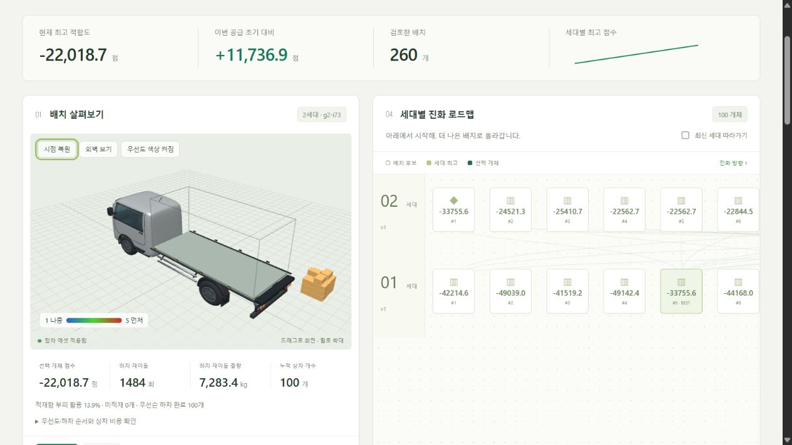

# 탑차 상자 배치·우선순 하차 프로그램: 현재 구현 기법 종합 보고서

- 버전: v0.0.1
- 최초 작성 일시: 2026-11-17 15:17:40 KST
- 수정 일시: 2026-11-17 15:21:03 KST
- 지시자: 이종인
- 작업자: GPT-6 (Codex) — 현재 소스 조사·기법 설명·근거 대조
- 기준 소스: `409e30573f91d64c0009835eca8a0cdfadea1106` (현재 보고서 작성 전 main)
- 관련 기능 ID: 001, SW_Browser_Packing_001, SW_Browser_Loading_001, SW_Browser_Unloading_001, SW_Browser_Evolution_001, SW_Browser_Arrival_001, SW_Browser_Scene_001, SW_Browser_EvolutionView_001, SW_Browser_ResultExport_001, SV_GitHubActions_Deployment_001. SW_Browser_StackLoad_001은 현재 비적용 구분에만 관련된다.
- 관련 계획: [현재 구현 기법 종합 보고서 작성 계획](../../plan/2026-11-17/150804_현재구현기법종합보고서_plan.md)
- 경로 기준: 본문의 `src/`, `tests/`, `scripts/` 등은 프로젝트 루트 기준이다. 링크는 이 보고서 위치에서 해석한다.
- 확인 방법: 현재 소스·설정 정적 열람, 기존 실행 로그 및 완료 기록 대조. 이번 작업은 문서 작성이며 프로그램 수정·성능 재측정·브라우저 재실행을 수행하지 않았다.

## 1. 목적·목표·조사 범위

목적은 이 프로그램을 처음 보는 사람이 **어디에 어떤 기법을 사용했고, 입력이 어떤 계산을 거쳐 결과가 되는지** 파악할 수 있게 하는 것이다. 목표는 실제 웹 실행 경로를 중심으로 기법의 적용 위치·동작·역할·선택 이유·한계·검증 근거를 연결하는 것이다. 선택 이유는 코드에서 확인할 수 있는 효과와 주석에 근거해 설명하며, 개발 당시의 의사결정을 추측하지 않는다.

조사 범위는 현재 `src/` 전체, 시험 14개 파일, 실행·검증·배포 스크립트 5개, 패키지·타입·Vite 설정, 에셋 사용 코드와 출처 안내, 현재 실행에 관련된 기록이다. 개별 CSS 속성을 전부 나열하는 대신 화면 구성·반응형·접근성 기법을 설명한다. 사용하지 않는 원본 에셋 내부의 모든 메시·텍스처나 npm 전이 의존성의 내부 알고리즘까지 자체 개발 기법으로 세지 않는다. 부록의 파일 목록으로 조사 범위를 검산한다.

## 2. 핵심 결과

현재 프로그램은 **유전 알고리즘과 배치 복구 휴리스틱을 결합한 제약 최적화 시뮬레이터**다. 휴리스틱은 모든 경우의 정답을 계산하는 대신, 유효한 배치를 빠르게 찾는 규칙을 뜻한다. 신경망 학습·강화학습·미분 최적화는 사용하지 않는다.

| 처리 위치 | 현재 사용 기법 | 얻는 결과 |
|---|---|---|
| 상자 입력 | seed 기반 의사난수, 등급 추첨, 거부 샘플링 | 규격을 만족하고 재현 가능한 상자 목록 |
| 배치 조건 | 축 정렬 직육면체 충돌, 밑면 합집합 지지, 경계 검사 | 겹치지 않고 떠 있지 않은 배치 |
| 후보 생성·복구 | 면 좌표 후보, 구획 분할, 최대 빈 지지면, 위상 정렬 | 전량 상차 가능한 후보와 상차 순서 |
| 진화 | 좌표·순서 인코딩, 토너먼트 선택, 1점 교차, 위치·순서 변이, 엘리트 | 부모의 배치를 바꿔 만든 다음 후보 |
| 하차 | 고정 우선순위 정렬, 재귀 의존 해소, 임시 반출·복귀, 복귀 실패 복구 | 전량 하차 여부와 재이동 횟수·중량 |
| 선택 기준 | 가중합 적합도와 하드 제약, 전원 완료 후 세대 확정 | 비용이 적은 유효 배치 보존 |
| 실행 | Web Worker, 생성기 yield, 시간 묶음, 실행 ID | 계산과 화면 분리·중단·진행 표시 |
| 관찰·저장 | Three.js, 이벤트 재생, 세대 행 가상화, 확정 스냅샷, SVG/PNG/ZIP | 실제 결과의 관찰과 다운로드 |

현재 웹의 최종 흐름은 다음 순서다. **상자 생성 → 후보 배치·상차 순서 생성 → 전량 상차 검사 → 우선도 순 전량 하차 계산 → 재이동 비용 점수 → 전원이 완료하면 세대 확정 → 선택·교차·변이로 다음 세대 생성**. 3D는 이 계산 결과를 보여준다. 사용자가 애니메이션을 끝까지 재생해야 다음 세대를 계산하는 구조는 아니다.

기존 실행 확인 이미지: 100개를 모두 하차한 선택 개체의 재생 마지막 상태다. 짐칸 밖 팔레트 소품은 입력 상자가 아니다. 이번 문서 작업에서 새로 촬영한 이미지는 아니다.



## 3. 상세 내용·코드 근거

### 3.1. 전체 구성과 자료 모델

근거: [main.tsx](../../../src/main.tsx), [model.ts](../../../src/domain/model.ts), [App.tsx](../../../src/ui/App.tsx), [evolution.ts](../../../src/workers/evolution.ts).

React 진입점이 `App`을 렌더링하고, 앱이 입력과 실행 제어를 담당한다. 별도 Worker는 `Engine`을 호출하며, Engine은 배치·상차·하차 모듈을 사용한다. 이 책임 분리는 같은 평가기를 화면 재생·자동 시험·비교 실험에서 재사용하게 한다. HTTP 기반 계산 서버나 데이터베이스는 없다. 배포 시 정적 JS와 GLB 파일을 받지만 계산 입력을 원격 추론 서버로 보내지는 않는다.

`Box`는 `id`, `size:[폭,깊이,높이]`, `weight`, `priority`, `grade`를 가진다. `Individual`은 배치 좌표 `coords`, 상차 ID 순열 `loadOrder`, 고정 하차 순서 `unloadOrder`, 부모 ID, 생성 방식, 상차 평가, 하차 평가, 점수, 가중치 버전을 가진다. `Generation`은 개체 집단, 최고·평균 점수, 시도·평가 수, 계산 시간, 공급 회차 및 당시 상자·설정·가중치를 담는다. TypeScript 인터페이스는 이 구조를 컴파일 시 검사하며, 런타임 유효성은 별도 함수가 검사한다.

계산 좌표의 단위는 cm다. x는 폭, y는 출입구에서 안쪽으로 들어가는 깊이, z는 높이이며 입구는 y=0이다. 좌표는 정수이고, 직육면체는 축에 평행하며 상자 회전 유전자가 없다. `[-1,-1,-1]`은 호환 부분배치 계산에서 미배치를 뜻하지만, 현재 웹에서는 미배치 개체를 완성 세대로 승인하지 않는다.

### 3.2. 상자 생성: 재현 가능한 의사난수와 거부 샘플링

근거: [model.ts의 Random·gradeOf·generateBoxes·resolveBoxInput](../../../src/domain/model.ts).

1. `Random.next`는 32비트 비트 연산·정수 곱셈 기반 의사난수를 만든다. 암호용 난수가 아니며 동일 seed의 실험을 재현하기 위한 것이다. `int`는 양 끝을 포함한 정수, `shuffle`은 Fisher–Yates 방식의 뒤에서 앞으로 교환하는 순열을 만든다.
2. 등급 0~4를 균등 추첨한다. 각 상자가 각 등급에 속할 확률이 20%라는 뜻이며, 20개 입력에 매 등급이 반드시 4개씩 나오는 할당 방식은 아니다.
3. 각 변을 10~100cm 정수로 뽑고 해당 등급의 세 변 합을 넘으면 버린다. 중량은 0.1kg 간격으로 생성한다.
4. `gradeOf`가 크기와 무게를 함께 수용하는 **최소 등급**을 계산한다. 추첨한 등급과 최종 등급이 같을 때만 채택한다. 이 반복 선별이 거부 샘플링이며, 등급마다 최대 10,000번 후 오류를 낸다.
5. 우선도는 1.0~5.0 사이를 0.1 간격으로 생성한다. ID는 최초 목록에서 1부터 순서대로 부여한다. 자동 공급은 기존 최댓값 이후의 ID를 부여해 같은 실행 안에서 새 상자와 충돌하지 않게 한다. 같은 상자는 세대와 공급 회차가 바뀌어도 ID와 우선도를 유지한다. 초기화된 별도 실행까지 ID를 영구 보관하는 UUID 체계는 아니다.

현재 코드의 등급 상한은 극소형 80cm/2kg, 소형 100cm/5kg, 중형 120cm/10kg, 대형 140cm/15kg, 특대형 160cm/20kg이다. 이 보고서는 **코드에 들어 있는 실험 규칙**을 기록하며 현재 운송사 요금·계약 기준을 재조사한 문서가 아니다. 최장변 100cm 제한은 현재 생성·검사에서 모든 등급에 적용된다. 각 변 최소 10cm, 등급 균등 추첨은 실험 모델의 선택이며 실제 택배 분포를 추정한 결과가 아니다.

입력 seed와 GA seed는 분리한다. 전자는 상자 목록, 후자는 진화 선택·변이에 영향을 준다. `resolveBoxInput`은 수량·입력 seed가 같으면 편집된 우선도 목록을 재사용하고 다르면 실제 상자를 새로 생성한다. 공급 난수와 도착 순서도 별도 seed 변형을 사용한다.

### 3.3. 입력 검증: 정규화와 계산 경계의 재검사

근거: [ranges.ts](../../../src/domain/ranges.ts), [model.ts](../../../src/domain/model.ts), App의 `Field/start/changeCount/changePriority/apply`, Worker의 `validateWebConfig` 호출.

| 항목 | 현재 웹 허용 입력 | 기본값·특별 동작 |
|---|---|---|
| 최초·회당 상자 수 | 정수 1~400, 누적도 최대 400 | 20, 소수는 버림, 초과는 경고 후 400, 빈값·0 이하 등은 확정 시 1 |
| 가중치 base/moves/mass/space | 각각 1~501, 소수 허용 | 100/10/1/20 |
| 집단 크기 | 정수 0~101 | 50, 0은 실행하지 않고 안내 |
| 공급 회차당/고정 탐색 세대 | 정수 1~10,001 | 100 |
| 교차율 | 0.1~1.1 | 0.9, 실제 확률은 0~1로 제한 |
| 상자별 변이율 | 0.01~1 | 0.05 |
| 토너먼트 k | 정수 1~6 | 3, 복원 추출이어서 작은 집단에도 적용 |
| GA·입력 seed | 정수 0~4,294,967,295 | 각각 2026 |
| 짐칸 폭/깊이/높이 | 정수 10~2000cm | 220/520/220cm, 실측 차량 제원 아님 |
| 상자별 우선도 | 유한한 수 1~5 | 생성은 0.1 간격, 화면 step=0.1, 실행 검사는 범위·유한성 검사 |

`Field`는 편집 중 숫자를 유지하고 포커스를 벗어날 때 `normalizeNumber`로 보정한다. 일반 정수 설정은 반올림하며 상자 수만 `normalizeBoxCount`에서 버림한다. UI의 min/max만 믿지 않고 시작 전과 Worker 진입 시 다시 검사한다. 웹 범위를 검사하는 `validateWebConfig`와 호환 계산을 허용하는 `validateConfig`는 구분된다. 후자는 0 가중치·0 교차·0 변이 실험을 허용하므로 독립 API의 허용 범위가 웹보다 넓다.

입력·짐칸·GA 설정은 실행 이력이 있으면 잠그고 초기화 후 변경한다. 우선도는 실행·도착 전에 수정하며 GA가 배송 우선도를 임의로 진화시키지 않는다. 가중치는 별도 적용 버튼으로 실행 중 변경할 수 있다. 잘못된 ID 중복, 규격·유한성 위반은 계산 진입에서 거부한다.

### 3.4. 공간 조건: AABB 충돌과 밑면 합집합 지지

근거: [packing.ts의 interval·collides·supported·fits·validateLayout·blockers](../../../src/domain/packing.ts).

- **구간 교차/AABB**: x·y·z 세 축 구간이 모두 겹치면 부피 충돌이다. 각 축은 `a < b+other && b < a+size`라는 엄격 부등식을 사용해 면·모서리 접촉은 허용한다. AABB는 축 정렬 경계 상자로 하는 검사라는 뜻이다.
- **경계 검사**: 각 좌표가 정수·0 이상이고 상자의 반대쪽 끝이 짐칸 크기 이하여야 한다. 경계 밖·공중부양·다른 상자 내부 배치는 점수 감점으로 허용하지 않고 거부한다.
- **밑면 전체 지지**: z=0이면 바닥이 받친다. 그 위면 상자 밑면과 정확히 같은 높이에서 닿는 다른 상자들의 윗면 합집합이 밑면 전체를 덮어야 한다. 받침 한 개가 전체를 덮으면 즉시 성공한다. 여러 받침이면 x 경계를 잘게 나누고 각 띠의 y 구간을 병합해 빈틈을 찾는다. 가운데 구멍이 있는 단순 접촉 면적 합산을 전체 지지로 오인하지 않게 한다.
- **고정 좌표**: `validateLayout`은 지정된 fixed 좌표가 바뀌면 거부한다. 순차 도착 확정 배치와 연결된다.
- **직선 경로 방해**: `blockers`는 목표보다 입구 쪽(y가 작은)에 있고 x·z가 겹치는 상자를 찾는다. 자유로운 곡선·옆문 경로 탐색을 수행하지 않는다.

물리엔진의 중력 적분·충격·마찰·강체 운동이 아니라 정적인 기하 조건이다. 전체 지지는 하중 용량이나 압축 강도를 뜻하지 않는다. 아래 상자보다 상부 총하중이 무거우면 추가 감점하는 과거 논의는 현재 `priorityFitness`에 포함되어 있지 않다.

### 3.5. 초기 후보 생성: 면 좌표와 지연 탐색

근거: packing의 `candidateAxes/candidates/randomPosition/packSteps/pack`.

짐칸 모든 cm 격자를 훑지 않고, 바닥·벽·다른 상자의 시작면·끝면·상자 크기만큼 당긴 면으로 각 축의 후보 좌표를 만든다. 유효 후보를 쉽게 찾기 위한 면 접촉 기반 휴리스틱이다. 반드시 가능한 모든 3D 포장 해를 포함한다는 증명은 없다.

`randomPosition`은 x/y/z 축 목록만 보관한다. 큰 직교곱 좌표 배열을 미리 만들지 않고 하나의 정수 인덱스를 x/y/z로 풀어 후보를 검사한다. 기본 탐색은 무작위 시작점에서 원형으로 순회하며, compact 모드는 낮은 z → 큰 y → 작은 x 순으로 검사한다. 같은 높이의 받침 목록을 Map으로 묶어 재사용하며 유효한 첫 위치에서 중단한다.

`packSteps`는 고정 상자를 먼저 배치하고 나머지 상자의 순서를 섞는다. 부모 선호 좌표가 유효하면 보존하고, 무효 부분만 새로 찾는다. 선호 좌표가 있으면 낮은 상자를 먼저 놓아 지지를 보존하려 한다. 생성기는 상자 단위로 `yield`한다. 전량 조건에서 위치가 없으면 부분 후보를 일찍 반환하고 평가·복구 경로로 넘긴다. `pack`은 같은 생성기를 끝까지 소진하는 동기 래퍼다. 테스트와 Worker가 다른 배치 규칙을 가지지 않게 한다.

### 3.6. 전량 후보 복구: 구획 분할·최대 지지면·의존 그래프

근거: [packing.ts의 partitionPack·loadingOrder](../../../src/domain/packing.ts), [supportPacking.ts](../../../src/domain/supportPacking.ts), [engine.ts의 rescuePack](../../../src/ga/engine.ts).

**구획 분할** `partitionPack`은 짐칸을 하나의 빈 직육면체로 시작한다. 긴 변·부피·작은 난수 섭동·선호 좌표로 상자 순위를 만들고, 들어가는 구획 중 작은 공간을 고른다. 같은 크기면 뒤쪽을 선호한다. 구획 뒤에 붙여 놓은 뒤 앞쪽·옆쪽·상자 바로 위로 나눠 서로 겹치지 않는 빈 구획을 만든다. 위 구획은 아래 상자 윗면 안이어서 지지를 쉽게 보장한다. 단순한 분할 때문에 L자 공간 활용을 놓칠 수 있다.

**최대 빈 지지 사각형 방식** `supportSurfacePack`은 바닥과 상자 윗면의 빈 사각형 후보를 유지한다. 점유 부분을 좌·우·앞·뒤로 빼고 다른 후보에 완전히 포함된 사각형을 제거한다. 후보 사각형끼리는 겹칠 수 있지만 실제 점유 상자는 겹치면 안 된다. 이 방식은 단일 구획 분할이 놓친 L자 빈 공간의 대안 배치를 남긴다. 밑면적 등으로 큰 상자를 먼저 놓고 남는 변 길이 또는 남는 면적을 작게 하는 기준을 적용한다. 현재 Engine은 mode 0과 4를 번갈아 대안으로 시도한다. 함수가 지원하는 모든 mode를 웹의 매 시도에 전부 사용하는 것은 아니다.

`rescuePack`은 구획 결과가 전량이면 그대로 쓴다. 부분 배치이면 지지면 전략을 추가로 실행하고 더 많은 상자를 배치한 결과를 쓴다. 유효 개체를 만들기 전 연속 대안 복구가 32번을 넘으면 원인을 알린다. 유효 개체가 승인되면 이 실패 카운터를 초기화한다. 무한 재시도보다 응답 가능한 실패를 선택한 구조며, 실패는 포장 불가능의 수학적 증명이 아니다.

**상차 순서 복구**에는 두 경로가 있다. `loadingOrder`는 지지·경로가 가능한 다음 상자를 반복 채택한다. 더 복잡한 배치는 `dependencyLoadingOrder`가 받침을 먼저, 입구를 막는 상자는 나중에 싣도록 방향 그래프를 만든다. 진입 차수 0인 노드를 꺼내는 Kahn 방식의 위상 정렬을 사용하며 순환이면 null을 돌려준다. 정렬 결과도 실제 상차 평가기로 재검사한다.

### 3.7. 유전 알고리즘: 무엇을 진화시키는가

근거: [engine.ts의 Engine.select·offspring·next](../../../src/ga/engine.ts).

| 기법 | 실제 적용 | 역할·제한 |
|---|---|---|
| 직접 좌표 인코딩 | 고정 상자 배열의 인덱스마다 좌표 3개, 별도 상차 ID 순열 | 같은 상자의 위치와 투입 순서를 탐색. 상자 크기·무게·우선도는 유전자 아님 |
| 토너먼트 선택 | 현재 유효 부모 풀에서 k번 복원 추출 후 최고 점수 선택 | 음수 점수도 크기 비교 가능. 같은 부모가 여러 번 뽑힐 수 있음 |
| 1점 교차 | 잘라낸 인덱스 앞은 부모 A, 뒤는 B의 좌표 | 부모의 부분 배치를 결합. 충돌·지지 위반은 후속 복구 필요 |
| 순서 교차 | A의 앞부분 ID를 남기고 B 순서 중 그 ID를 제외한 나머지 연결 | 각 상자 ID가 한 번인 상차 순열 유지. 좌표와 독립적으로 평가 |
| 좌표 변이 | 상자마다 확률 검사, 경계 내 정수 좌표로 변경 후 복구 | 현재 우선순 하차 모드에서는 비싼 전수 유효 위치 탐색을 매 변이마다 하지 않음 |
| 순서 변이 | 순서 전체에 한 번 확률 검사 후 두 인덱스 교환 | 확률이 같아도 좌표 변이처럼 상자마다 적용하는 것은 아님. 같은 인덱스를 뽑을 수도 있음 |
| 엘리트 보존 | 이전 유효 집단의 최고 개체 1개 복사 | 같은 입력·점수 기준에서는 최고를 잃지 않게 함. 집단 1이면 이 보존만으로 진화가 정체할 수 있음 |
| 복구 연산자 | 무효 자식의 좌표·상차 순서를 휴리스틱으로 수정 | 하드 제약 유지. 복구 결과가 원래 교차 좌표를 상당히 바꿀 수 있음 |
| 실제 계보 기록 | parents·operation·repaired·version 기록 | 엘리트/복제/교차/변이/복구의 결과를 트리와 파일에서 추적 |

좌표 교차의 cut은 상자 배열 인덱스이고 순서 교차의 cut은 순열 위치다. 둘 다 같은 숫자를 사용하지만 같은 상자 집합의 경계를 뜻하지는 않는다. 우선도는 배송 입력이므로 GA가 높은 우선도를 낮춰 비용을 줄이는 편법은 없다. 회전·상자 분할·무게 변경도 하지 않는다.

교차 확률은 `effectiveCrossover`로 최대 1이다. 입력 1.1은 기록에 보존하되 실제 동작은 100%이며 상자 1개에서는 교차하지 않는다. `settings.generations`는 Engine.next 자체의 반복 제한이 아니라 Worker·실험 호출부가 적용하는 탐색 예산이다. Engine을 직접 호출하는 코드는 호출 횟수를 스스로 관리해야 한다.

### 3.8. 전량 상차 실행: 필요조건 선검사와 롤백

근거: [loading.ts의 completeSupportOrder·simulateLoading](../../../src/simulation/loading.ts), Engine.evaluateSteps.

`completeSupportOrder`는 순서대로 추가했을 때 밑면이 먼저 지지되는지 빠르게 확인한다. 저렴한 필요조건 검사이며 이것만으로 성공을 승인하지 않는다. `simulateLoading`은 순열 길이·ID·미배치 표기·최종 배치·고정 좌표를 검사하고 빈 짐칸 또는 fixed 배치에서 시작해 순서를 실제로 실행한다.

목표 상자의 직선 입구를 막는 상자를 임시로 꺼낸다. 받침을 제거하면 지지가 끊기는 상자도 재귀적으로 먼저 꺼낸다. fixed 상자는 상차 중 움직이지 않는다. 목표를 넣은 뒤 임시 상자를 유효한 원래 위치로 되돌린다. 이 동작 묶음이 실패하면 직전 적재 상태·이벤트 수·횟수·중량을 스냅샷으로 되돌린다. 실패한 가상 시도를 성공한 재이동처럼 누적하지 않는 **트랜잭션형 롤백**이다.

첫 상차 `load`는 재이동 감점이 없다. 상차의 `out/return` 비용은 별도 기록하지만 현재 GA의 감점은 이후 **하차 비용**을 사용한다. 상차에서 일부가 빠진 결과를 반환할 수 있는 호환 API는 남아 있으나 현재 웹은 loaded가 할당 수와 같지 않으면 후보를 탈락시킨다.

### 3.9. 우선순 하차: 의존성 해소와 안전한 복귀

근거: [priority.ts](../../../src/domain/priority.ts), [priorityUnload.ts의 priorityUnloadSteps](../../../src/simulation/priorityUnload.ts), [unload.ts의 simulateSteps·simulate](../../../src/simulation/unload.ts).

`priorityOrder`는 큰 우선도 먼저, 동점이면 작은 ID 먼저로 정렬한다. 현재 Engine과 화면은 `recover=true`를 사용해 `priorityUnloadSteps`로 들어간다. 상자 목록·규격·우선도는 같게 두고 초기 배치에 따른 하차 비용을 비교한다.

1. 배치 전체를 검사하고 ID→배열 인덱스 Map을 만든다. 각 상자의 내부/외부 상태는 active 비트, 배송 여부는 delivered 비트로 구분한다.
2. 현재 목표 상자를 빼기 전에 제거로 지지가 끊길 상자를 먼저 찾는다. 그다음 출입구 직선 경로의 방해물을 찾는다. 방해물 처리 순서는 입구 가까운 것, 높은 것, 작은 ID 등의 정해진 동점 규칙을 따른다.
3. 재귀 `extract`로 의존 방해물을 먼저 `out`한다. visiting 비트로 순환 호출을 감지한다. 현재 목표만 `deliver`하며 임시 반출은 배송 완료로 세지 않는다.
4. 임시 반출 상자는 원래 위치를 우선 시도하고, 같은 x/y에서 더 낮은 지지 높이, 다른 빈 구획 모서리 순으로 복귀 위치를 찾는다. 삽입 시에도 경계·지지·충돌·출입구 경로를 검사한다.
5. 복귀가 막히면 복귀 시도만 스냅샷으로 롤백한다. 아직 배송하지 않은 상자에 대해 target ID로 결정되는 별도 seed를 사용해 최대 32번 구획 재배치 계획을 시도한다. 가능하면 나머지 내부 상자도 추가 반출하고 계획 순서대로 다시 싣는다. 추가 정리도 모두 재이동 비용이다. 안전한 복귀가 안 되면 무효 결과다.
6. 목표마다 yield하고 마지막에는 `delivered===상자수`, `activeCount===0`, 모든 배송 비트 완료를 검사한다. 배송 ID 순서는 재생 이벤트 검사에서도 대조한다.

이 구조는 “우선 대상의 길을 방해물이 막는다”는 빨간차 게임의 원리를 응용한 것이다. 실제 구현은 게임의 차량별 고정 레일에서 최소 슬라이드 수를 완전 탐색하는 BFS/A*가 아니다. 상자를 잠시 짐칸 밖에 꺼내고 복귀시키는 결정적 휴리스틱이다. 짐칸 밖 대기 위치의 충돌·면적·작업자 수·이동 거리·운반 시간은 계산하지 않는다. 밖에 있는 상자의 정확한 3D 대기 좌표도 표시하지 않는다. 우선도가 낮은 상자의 배송을 앞당기지 않으면서 임시 이동은 허용한다.

### 3.10. 빈 공간 표현: 6방향 슬라브 차집합

근거: [spaces.ts의 occupy·freeRegions](../../../src/domain/spaces.ts), priorityUnload의 `replacement`.

짐칸 빈 직육면체에서 점유 상자와 겹친 부분을 뺄 때 좌·우·앞·뒤·아래·위의 최대 6개 슬라브로 나눈다. 조각은 서로 겹치지 않게 만들고 양의 크기만 보존한다. 복귀 후보를 찾을 때만 `freeRegions`를 지연 생성하며, 상자를 돌려넣으면 `occupy`로 갱신한다. 빈 구획에 크기가 들어간다는 것만으로 지지·경로를 승인하지 않고 `canInsert`가 다시 검사한다. 지지면 후보 사각형이 겹칠 수 있는 3.6의 방식과 이 비겹침 부피 분할은 서로 다른 용도다.

### 3.11. 적합도: 가중합 점수와 하드 제약

근거: [objective.ts의 priorityFitness](../../../src/simulation/objective.ts), loading의 coverage/utilization/compactness 계산.

현재 실제 코드:

```ts
return loading.valid&&unloading.valid?Math.round((w.base*loading.coverage+(w.space??20)*loading.compactness-w.moves*unloading.moves-w.mass*unloading.mass)*100)/100:-Infinity;
```

식의 의미는 다음과 같다.

```text
coverage = 0.5 × (실린 개수 / 할당 개수 + 실린 부피 / 할당 총부피)
utilization = 실린 부피 / (짐칸 폭 × 깊이 × 높이)
compactness = 실린 부피 / (짐칸 폭 × 높이 × 실제 상자가 차지하는 깊이 구간)
점수 = base × coverage + space × compactness − moves × 하차 재이동 횟수 − mass × 하차 재이동 누적kg
기본값 = base 100, space 20, moves 10, mass 1
```

부피는 cm³로 계산하되 비율은 무차원, 재이동 중량은 kg다. 점수는 소수 둘째 자리로 반올림하며 음수를 허용한다. 유효하지 않은 계산은 -Infinity 또는 후보 거부로 처리한다. 충돌·미지지·부분 하차를 감점만 받고 통과시키지 않는 **실행 가능성 우선 제약 처리**다.

현재 전량 상차 조건에서는 coverage=1이므로 base 보상은 모든 승인 개체에 공통 상수다. 따라서 동일 공급 회차·짐칸·상자 목록에서는 개수 증가 경쟁보다 공간 집중도와 하차 비용이 후보의 우열을 결정한다. utilization은 화면·다운로드에 표시하지만 식에 직접 들어가지 않는다. compactness는 깊이 구간을 줄이는 비율이며 점유 상자의 최소 3D 외접 직육면체 부피로 나눈 값과도 다르다. 같은 상자와 짐칸의 utilization은 배치를 바꿔도 일정하므로 세대마다 활용률이 반드시 증가하지 않는다.

**재이동 정의**: 방해 상자 `out` 1회와 `return` 1회는 각각 1회이며, 각각 그 상자의 무게를 더한다. 동일 상자를 여러 번 옮기면 매번 더한다. 배송 대상 자체의 `deliver`는 횟수·kg 감점에서 제외한다. 거리나 물리적 일량이 아니라 “다시 취급한 횟수와 중량의 합”을 최소화한다. 우선도별 감점 배수는 없고 우선도는 하차 순서를 통해 비용에 간접 영향을 준다.

손계산 근거: `tests/unloading-gate.test.ts`의 P5 상자 뒤/P1 3kg 상자 앞 배치에서는 `out #2 → deliver #1 → return #2 → deliver #2`이다. 재이동 2회/6kg, 기본 감점 20+6=26점이다. 완전 밀집 보상 120점 기준 결과는 94점이며 같은 상자의 자유 경로 배치는 120점이다. 다른 fixture에서 space=0이면 별도로 100→76점인 검사가 있으므로 서로 다른 가중치 예시를 혼동하면 안 된다.

### 3.12. 전원 완료 조건과 세대의 일괄 확정

근거: Engine의 `evaluateSteps/completedUnloading/next`, [unloading-gate.test.ts](../../../tests/unloading-gate.test.ts).

전량 상차·하차 결과를 얻은 후보만 완료 집단에 추가한다. `completedUnloading`은 상차 valid, loaded=할당 수, 미적재 ID 없음, 하차 valid, delivered=할당 수, 하차 순서 길이와 현재 우선순 ID열의 일치를 함께 요구한다.

같은 판정을 엘리트·부모 풀 필터, 새 후보 수집, 세대 최종 확정에서 반복 사용한다. 고득점 캐시라도 미완료·기록 없음·순서 불일치이면 부모가 될 수 없다. 임시 next 배열에 설정 집단 수만큼 모은 뒤 최종 전원 검사가 끝나야 `population=next; generation++`를 실행한다. 그전 yield 구간은 준비 상태다. 실패하면 이전 확정 세대와 집단을 유지한다. 이 보장은 세대/집단의 확정에 관한 것이며 시도 중 소비된 난수·평가 카운터까지 되감는 전체 엔진 롤백은 아니다.

사전에 각 상자 치수가 짐칸보다 큰지, 총부피가 짐칸보다 큰지 검사한다. 초과하면 전량 적재 불가능의 명확한 필요조건 위반으로 중단한다. 통과했다고 실제 배치 가능함을 보장하지는 않는다. 후보 시도는 집단 수×120, 별도 대안 복구는 유한 한도를 둔다. 이번 최종 조건은 **모든 개체의 할당 상자 전량 상차·우선순 전량 하차**이며, 짐칸 100% 충전·모든 애니메이션 종료·점수 임계값이 아니다.

### 3.13. 자동 공급과 순차 도착은 별도 운영 모드

근거: [supply.ts](../../../src/simulation/supply.ts), [arrival.ts](../../../src/simulation/arrival.ts), Worker의 tick, App의 receive/commit.

자동 공급은 한 회차의 설정 세대 수를 마쳤을 때 최고 개체를 기준으로 `availableLoadingSlot`을 호출한다. 최소 생성 크기인 10×10×10cm 시험 상자에 대해 지지·겹침·입구 경로가 가능한 후보 위치가 있는지 지연 탐색한다. 공간이 있고 누적 400개 미만이면 다음 묶음을 추가한다. 마지막 묶음은 400개까지 남은 수만큼만 생성한다. 최소 상자 한 개가 들어간다고 다음 랜덤 묶음 전체가 들어간다는 보장은 없다.

다음 회차는 이전 상자 객체·ID·우선도를 보존하고 최고 배치의 상차 완료 좌표를 seedLayout으로 전달하지만, 일반 자동 공급의 fixed는 빈 목록이다. 이전 상자를 영구 고정하지 않고 누적 전체 목록의 배치를 다시 개선할 수 있다. 하차 후 실제로 빈 짐칸에 새 물건을 넣는 물류 운행이 아니라 **누적 입력 크기를 확장하는 최적화 실험**이다.

회차 전환 시 Engine은 새로 만들고 GA seed를 1 증가시킨다. 전역 표시 세대·평가 수는 offset으로 이어가며 개체 ID에는 `r회차-` 접두어를 붙인다. 상자 수·난수·집단이 바뀌므로 회차 전후 점수는 같은 실험의 개선량으로 직접 비교하지 않는다. 새 회차 부모는 새 Engine에서 생성되므로 이전 회차와 가짜 부모 연결을 만들지 않는다. 추가 공간을 못 찾았다는 메시지는 현재 탐색 규칙의 결과이며 빈 공간 0의 완전 증명이 아니다.

순차 도착 `Arrival`은 별도 난수 순열, cursor, 대기 최대 40개, loaded와 fixed를 관리한다. 선택 배치 확정 시 실제 상차 순서를 검증하고 기존 좌표를 고정한다. 자동 공급을 켜면 순차 도착을 해제한다. 대기 40개는 누적 400개 제한과 다르다.

### 3.14. 실행 최적화: Worker·협력적 양보·배치 메시지

근거: [evolution.ts](../../../src/workers/evolution.ts), Engine 생성기, App의 createWorker.

- **계산 스레드 분리**: Module Web Worker에서 GA를 실행한다. 3D와 입력은 메인 스레드에서 처리한다. 개체마다 별도 Worker를 돌리는 병렬 GA는 아니며, 단일 진화 Worker와 독립 비교 실험 Worker가 있다.
- **협력적 스케줄링**: pack의 상자 단계, 하차의 목표 단계, next의 후보 단계에서 yield한다. Worker는 약 12ms 예산 동안 생성기를 진행하고 `setTimeout(tick,0)`으로 메시지 처리 기회를 준다. 단일 동기 단계가 길면 12ms를 넘을 수 있어 엄격한 실시간 응답 보장은 아니다.
- **메시지 묶음**: 빠른 세대는 tick 내 완성된 결과를 `generations`로 묶어 보낸다. 완료·다음 공급·오류 알림 전에 flush하여 확정 세대를 누락하지 않는다. 샘플링해서 일부 세대를 버리는 방식이 아니다.
- **진행 알림 제한**: 준비 중 전량 할당 진행 메시지는 250ms보다 자주 보내지 않게 한다. UI는 준비 세대, 상차·하차 완료 개체 수, 최다 배치 수, 시도 수를 표시한다.
- **실행 ID 격리**: 명령과 응답에 run을 넣고 앱은 이전 실행 응답을 무시한다. 재시작·초기화 시 이전 Worker를 terminate한다. 타이머도 중복 예약하지 않는다.
- **일시정지/재개**: 계산 생성기·엔진·난수 상태를 유지해 이어서 진행한다. stop은 미완성 iterator를 버리고 stopped로 막는다. 컴포넌트 해제 시 Worker를 종료한다.

UI의 애니메이션 속도는 별도 650ms 이벤트 간격이고 GA 난수 seed와 다르다. 애니메이션 재생 속도를 바꿔 진화 계산이 빨라지는 구조는 아니다. 페이지를 새로고침하면 현재 실행 메모리는 사라지며 localStorage나 서버에 장기 저장하지 않는다.

### 3.15. 계산 내부의 자료구조·할당 최적화

근거: packing.randomPosition, priorityUnload의 관계 배열·active·heights·activate, Engine.evaluateSteps.

하차의 방해·지지·완전 받침 관계는 각각 길이 n²의 `Uint8Array`로 관리한다. active·delivered·visiting도 바이트 배열이다. 400개라면 관계 배열 세 개의 원소 데이터는 480,000바이트이며, 전체 프로그램 메모리 사용량이 이 수치라는 뜻은 아니다. 배열 인덱스로 상태를 검사해 반복적인 객체 배열 필터·복사를 줄인다.

좌표가 바뀐 상자가 복귀하면 해당 상자의 관계 행·열만 다시 계산한다. 높이별 상단 개수는 Map으로 유지하고, 한 받침이 전 밑면을 덮는 빠른 경로를 둔다. 밖으로 꺼낼 때 모든 좌표를 복사해 새 배열을 만들기보다 활성 비트와 높이 카운터를 바꾼다. 복귀 후보가 막힐 때만 빈 공간 목록을 계산한다.

GA 평가는 `trace=false`로 이벤트 배열을 쌓지 않고 요약 비용만 보관한다. 사용자가 선택한 개체에 대해 동일한 평가기를 `trace=true`로 다시 실행해 재생을 만든다. 이로써 모든 세대·모든 개체의 긴 이벤트 전체를 항상 Worker에서 전송하지 않는다. 좌표·부모·평가 기록은 세대마다 남으므로 전체 이력 메모리는 여전히 세대×집단×상자 수에 비례해 커질 수 있다.

관계 전처리는 O(n²), 각 목표는 활성 상자를 순회하고 필요하면 재귀·복귀·재계획을 하므로 전체가 항상 선형이라는 주장은 할 수 없다. 같은 결과를 보존한 최적화인지 확인하려고 기존 이벤트 및 세대 해시와 난수 소비 동등성 검사를 둔다. 이번 보고서에서는 측정하지 않은 속도 향상 배수를 기재하지 않는다.

### 3.16. 가중치 적용: 버전 관리와 과거 이력 보존

근거: Engine.reweight, Worker weights 명령, App.apply 및 weightVersions.

가중치를 바꾸면 현재 계산을 일시정지하고 **미완성 세대만 폐기**한다. 기존 현재 집단의 상차·하차 평가 수치는 다시 시뮬레이션하지 않고 새 가중치로 점수만 다시 계산한다. 버전을 올리고 UI의 현재 최고·선택 개체·적용식을 갱신한다. 이전 세대의 당시 점수는 수정하지 않는다. 가중치 변경 이후 재개하면 새 기준으로 선택한다.

진행 중 소비된 난수 상태는 보존하며 이전 미완성 세대의 시작점으로 되감지 않는다. 가중치 편집만 한 상태와 적용 완료 상태를 구분한다. 첫 세대 전에도 Worker가 있으면 명령을 전달한다. 결과 확정 뒤에는 새 가중치를 적용하지 못하게 하고 새 실행을 안내한다.

### 3.17. 3D: 표시 좌표계·GLB·공통 큐브와 이벤트 재생

근거: [truckFrame.ts](../../../src/scene/truckFrame.ts), [TruckView.tsx](../../../src/scene/TruckView.tsx), [ASSETS.md](../../../Asset/ASSETS.md).

Three.js의 PerspectiveCamera·WebGLRenderer·OrbitControls·조명·GridHelper를 사용한다. GLTFLoader로 탑차와 팔레트 GLB를 비동기 로드한다. 실제 계산 상자는 규격별 직육면체이고 팔레트 메시를 상자 하나하나의 충돌 형상으로 사용하지 않는다. 팔레트 C에서 추출한 텍스처를 상자 재질에 쓰고 원본 소품은 짐칸 밖에 배치한다. D 모델은 참조용 보존이며 현재 렌더러에서 로드하지 않는다.

계산 cm를 m로 바꾸고, 계산 x/y/z를 화면 폭/차체길이/높이에 대응시킨다. `TRUCK_FRAME`의 앞 -0.82, 뒤 3.44, 바닥 1.15, 천장 3.25, 반폭 1.1이라는 에셋 내부 기준으로 모델·바닥·상자에 공통 스케일을 적용한다. 기존 운전석 침범을 피하는 기준이다. 축별 비균등 스케일을 사용하므로 실차의 물리 치수 재현이라고 볼 수는 없다.

바닥은 공통 BoxGeometry에 단색 floorMaterial을 적용한 큐브다. 상자 재질·팔레트 에셋을 바닥으로 쓰지 않는다. 외벽 토글은 원본 메시 중심 위치를 기준으로 일부 메시를 숨기는 표시 기법이며 실제 문 열림 애니메이션이 아니다.

하차 재생은 상차 완료 좌표에서, 상차 재생은 빈 상태 또는 fixed 배치에서 시작한다. Map에 상자 위치를 넣고 선택 단계까지 이벤트의 `to`를 적용한다. out/deliver의 null은 짐칸에서 사라짐, return/load는 새 좌표 표시다. 프레임 사이 연속적인 물리 궤적 보간은 하지 않는다. 마지막 동작 상자는 테두리로, 우선도는 1 파랑→5 빨강으로 표시하며 등급 색으로 전환할 수 있다.

지오메트리·에지와 재질은 공유하고, 우선도 재질은 Map으로 재사용한다. GLB는 좌표 변경마다 다시 받지 않는다. 카메라 조작·데이터 변경·리사이즈 시에만 requestAnimationFrame을 예약하는 요구 기반 렌더링을 사용한다. 픽셀 비율은 최대 2다. ResizeObserver로 화면 크기를 반영하고 해제 시 geometry/material/texture·controls·renderer·관찰자·프레임을 정리한다. InstancedMesh 방식은 사용하지 않는다. GLB 실패 시 계산용 짐칸을 남기고, WebGL 실패 시 안내한다.

### 3.18. 진화 로드맵·반응형 화면·접근성

근거: [GenerationTree.tsx](../../../src/ui/GenerationTree.tsx), [App.tsx](../../../src/ui/App.tsx), [style.css](../../../src/style.css), [index.html](../../../index.html).

로드맵은 최신 세대를 위에 두도록 이력을 역순으로 배치한다. 각 개체의 실제 parents ID를 이전 세대 인덱스로 연결하고 SVG 베지어 곡선으로 그린다. 엘리트·최고·선택 상태를 구별한다. 점수가 같다는 이유로 가상의 부모 연결을 만들지 않는다.

고정 행 높이132px을 기준으로 스크롤 위치와 표시 높이에서 start/end를 계산해 보이는 세대 행과 앞뒤 여유 1행만 렌더링한다. **행 가상화**이며 실제 메모리의 전체 세대 기록이나 각 보이는 행의 전체 개체를 줄이는 방식은 아니다. 클릭하면 선택 개체를 3D에 보여주고 follow를 끈다. 최신 따라가기는 맨 위로 이동하며 직접 스크롤하면 해제된다.

React의 state는 표시값, ref는 Worker·현재 설정·실행 ID·캡처 함수, useMemo는 선택 개체 재생·우선도 순위 등의 재계산 제어에 쓴다. CSS Grid/Flex와 1500/1100/850/480px 등의 미디어 쿼리로 좌우 패널을 세로 배치로 바꾸고 표는 가로 스크롤한다. 접근성은 aria-label·role=status/alert·aria-pressed·키보드 초점 표시·prefers-reduced-motion을 사용한다. 전체 WCAG 적합성을 인증한 검사는 아니다.

### 3.19. 완료 시점 확정: 복사 스냅샷과 지연 응답 차단

근거: App.complete, [report.ts의 ResultSnapshot·finalizeResult](../../../src/export/report.ts), [ResultExport.tsx](../../../src/ui/ResultExport.tsx).

자연 계산 완료와 다운로드용 **완료·결과 확정**은 구분된다. 후자의 버튼은 완성 세대가 하나 이상일 때 사용한다. 당시 history·선택 개체·가중치 버전·설정·3D 카메라 렌더 이미지·재생 단계·상자·이벤트를 모으고 `structuredClone`으로 실행 객체와 참조를 끊는다. Object.freeze로 모든 하위 객체를 강제로 동결하는 것은 아니며, 앱이 복사한 스냅샷을 별도로 보관하고 수정하지 않는 방식이다.

완료 후 Worker를 종료하고 run을 증가시켜 늦은 응답을 무시한다. 준비 중인 세대는 history에 없으므로 포함하지 않는다. 재생도 멈추고 스냅샷이 있어야 다운로드 필드를 활성화한다. 초기화·처음부터 시작하면 스냅샷을 없애 다시 잠근다. 이후 화면 선택·시점 변경이 확정한 3D 이미지를 바꾸지 않는다. 캡처 실패 시 원인을 기록하고 다른 그래프는 저장할 수 있다.

### 3.20. 결과 시각화·파일: SVG 원본, PNG 변환, 저장 ZIP

근거: [report.ts](../../../src/export/report.ts), [files.ts](../../../src/export/files.ts), ResultExport.save.

화면 스크린샷에 보이는 일부만 잘라 저장하지 않고, 완료 자료에서 **전체 데이터 기반 SVG**를 직접 생성한다. 제목·축·단위·범례·완료시각·입력/GA seed·가중치·집단·세대 범위를 붙인다. XML 특수문자는 escapeXml로 이스케이프한다. 완료 시각은 ISO UTC로 보관하고 이미지에는 KST로 표시한다.

출력은 ① 전체 진화 로드맵 ② 최고·평균 점수 ③ 최고 점수 개체의 재이동 회수·kg 각각의 그래프 ④ 적재 개수와 부피 활용·공간 집중도 ⑤ 실행 요약 ⑥ 선택 개체 우선도·하차 순위 표 ⑦ 선택 개체 3D PNG다. 최고 점수 개체의 이동량은 전체 개체 평균이나 이동량 자체의 최솟값을 뜻하지 않는다. 서로 다른 단위를 한 축으로 혼합하지 않는다.

공급 회차·가중치 버전·연속하지 않는 세대가 바뀌면 `segments`로 추세선을 끊는다. 로드맵은 6세대×10개체씩 분할하고 페이지 밖 부모 ID도 표기한다. 요약·우선도표는 30행씩 나눈다. 범위를 지정해도 우선도표·3D는 완료 당시 선택 개체의 자료라는 사실을 명시한다. 노드·세대를 임의로 샘플링해 버리지 않는다.

PNG는 폰트 준비를 기다린 뒤 SVG Blob을 Image로 읽어 Canvas2D에 그리고 toBlob으로 만든다. 3D는 렌더러를 즉시 한 번 그린 뒤 toDataURL로 캡처한 PNG를 설명 프레임에 포함한다. Canvas API를 사용하는 것이며 별도 서버 이미지 생성은 아니다.

ZIP은 외부 압축 라이브러리 없이 store 방식으로 구현한다. TextEncoder의 UTF-8 파일명, CRC32, little-endian DataView 헤더, 중앙 디렉터리, 끝 레코드를 만든다. **무압축 ZIP**이므로 용량 압축 효과는 없다. 파일 65,535개·32비트 크기 한도를 검사하며 ZIP64는 없다. 다중·전체 다운로드에는 result.json과 안내.txt도 들어간다. JSON은 좌표·부모·이벤트·설정을 보존하되 이미지 중복 저장은 제외한다. Blob URL·다운로드 anchor를 사용하고 URL을 해제한다.

파일 생성 중 await/setTimeout으로 화면에 양보하고 job ref로 중복 실행을 막으며 취소 플래그로 다음 작업을 중단한다. 생성한 파일을 메모리에 모으므로 장기·대집단의 전체 PNG+SVG ZIP은 여전히 큰 메모리를 요구한다. 스트리밍 ZIP·서버 저장은 구현되어 있지 않다.

### 3.21. 비교 실험: 동일 입력·평가 예산과 여러 seed

근거: [experiments.ts](../../../src/ga/experiments.ts), App.experiment, [experiment.ts](../../../scripts/experiment.ts).

현재 웹은 별도 Worker에서 우선순 하차 목적을 켜고 9조건×seed 11/29/47=27회를 실행한다. 실제 조건은 교차 0.1/0.6/0.9, k 2/3/5, 변이 0.01/0.05/0.2이다. 조건마다 바꾸지 않는 GA 항목은 함수 내부 기준 교차0.9·변이0.05·k3으로 맞춘다. 사용자 설정은 집단·세대 등 나머지 항목에 반영된다.

GA 평가 수와 무작위 비교군 평가 수를 맞춘다. 같은 상자·짐칸·가중치·우선순 하차 목적의 evaluate를 쓰고 점수·재이동·중량·적재·부피·예산·유효 비율을 기록한다. 여러 seed의 평균도 표시하고 JSON을 저장한다. 비교군이 유효 해답을 못 찾으면 오류를 알린다. 동일 평가 수는 동일 시간·동일 후보 생성 난이도를 보장하지 않는다. 무작위 군은 GA의 모든 복구 전략을 그대로 공유하지 않으므로 결과를 순수 유전 연산만의 인과 효과나 통계적 유의성으로 단정하면 안 된다. 신뢰구간·가설검정은 없다.

화면 설명은 교차0·변이0을 여전히 적고 있으나 **현재 웹의 실제 조건은 위의 0.1·0.01**이다. 이 표시 불일치는 조사에서 확인한 문서화 대상이며 프로그램 수정은 하지 않았다. 명령 `npm run experiment`의 스크립트는 마지막 priorityUnloading 인수를 생략하므로 현재 웹 목적이 아닌 상차 호환 비교다. 이 차이를 현재 우선순 하차 실험 결과로 혼용하면 안 된다.

### 3.22. 시험·디버깅·성능 확인 기법

근거: [tests 폴더의 각 시험 파일](../../../tests/), [range-sweep.ts](../../../scripts/range-sweep.ts), [benchmark.ts](../../../scripts/benchmark.ts), [기존 전량 하차 완료 기록](../../plan/2026-11-17/142042_우선순전량하차세대완료조건_plan.md).

시험 도구는 Node 내장 test/assert와 tsx다. 단순 실행 성공뿐 아니라 결과 불변식과 실제 전이를 검사한다.

| 시험 파일 | 확인하는 기법·조건 |
|---|---|
| domain.test.ts | 5등급·난수 재현, 면 접촉, 지지 합집합, 손계산 하차, 도착·고정, 계보 |
| loading.test.ts | 최초 상차 무료, 방해 반출·복귀, 부분배치 호환, 단계별 물리 조건, 롤백·고정 |
| allocation.test.ts | 전원 할당 완료 전 세대 금지, 불가능 입력, 순서 복구의 ID 보존 |
| nondefault.test.ts | 비기본 12/35/48개·가중치·설정 및 시도 수 회귀 |
| performance.test.ts | 35/48개 세대 전체 SHA-256 골든 해시, 후보 순서·난수 소비 동등성 |
| large.test.ts | 100/220개 여러 설정, 다양성·계보·물리 제약, Worker 정지/재개, 구획 복제 |
| priority.test.ts | 우선도 교환 효과, 고정 정렬, 실제 개선, 이벤트 해시, 220개 각 전이, 비교 예산, 공급 계승 |
| input-limit.test.ts | 1~400 보정, 입력 반영, 누적 390→400, 100/256/360/400개 Worker |
| support-packing.test.ts | 기본 짐칸 400개 전량 복구, 최대 지지면의 안전성, 위상 순서·실패 한도 |
| ranges.test.ts | 범위 경계, 집단0, 집단1/k6, seed 양끝, 1.1 실효 확률, 10,001세대·묶음 전달 |
| supply.test.ts | 기본20·18개 고정 중단 회귀, 공간 검사, 회차 연결, 전량 조건·불가능 안내 |
| truck-frame.test.ts | 운전석/짐칸 비겹침, 변경 치수의 공통 좌표 변환 |
| export.test.ts | 복사 스냅샷, 그래프 단위·부호·버전, 페이지 밖 개체·부모, XML·CRC32·ZIP |
| unloading-gate.test.ts | 실제 전량 하차, 미완료 고득점 부모 차단, 부분 후보 거부, 최종 확정 재검사 |

일부 Worker 시험은 Node 전역의 self/postMessage를 시험용으로 연결해 **실제 Worker 모듈의 명령 처리 코드**를 실행한다. 모든 시험이 실제 브라우저의 독립 OS 스레드를 띄우는 E2E 검사는 아니다. 기존 브라우저 조작·콘솔·마지막 재생 확인 기록은 이 시험과 별도로 존재한다.

골든 해시는 시간만 제외한 전체 세대 또는 전체 하차 이벤트·비용을 SHA-256으로 비교한다. 속도 개선 중 결과·난수 소비가 바뀌지 않았는지 검출하는 **결정적 회귀 검사**다. 이전 상차 호환 해시가 통과한 사실을 현재 하차 성능 향상 수치로 쓰지 않는다. 전량 하차 테스트의 부분결과 주입은 테스트 전용 결함 모사이며 운영 코드에서 그런 실제 오류가 발생했다고 주장하는 근거가 아니다.

범위 검사는 다른 항목을 고정하고 각 9개 항목을 최소~최대 10% 간격의 11단계로 실행한다. 총99조건 중 집단0 하나는 안내만 확인하고 98개는 계산·마지막 재생·점수식 대조를 한다. 정수 항목은 반올림한다. 모든 설정 조합의 직교곱 시험이 아니며 기준 fixture는 상자 2개다. 대형 상자 수 검사는 별도 시험의 해당 조합으로 한정한다.

기존 최신 실행 로그를 이번에 다시 열어 확인한 결과는 **97개 통과/실패0**, 범위 **99조건(98실행/1안내), 55,272세대, 588재생 전이**, TypeScript 및 Vite 빌드 성공이다. 로컬 로그 위치는 `artifacts/unloading-gate/tests.log`, `range-test.log`, `build.log`이며 artifacts는 gitignore 대상이다. 원격 독자는 위의 커밋된 완료 기록과 시험 소스를 참고할 수 있다. 이번 문서 작업에서 이를 새로 재실행한 것으로 표시하지 않는다.

벤치마크는 performance.now로 세대 경과 시간을 재고 시도 수·적재 범위·최고점수·해시를 JSON으로 남긴다. `--priority`가 있어야 현재 하차 목적이고 `--large`는 100/220개다. 이 경과 시간은 순수 CPU 시간이나 3D 화면 표시 시간과 다르다. `smoke-loading.ts`는 18개/100세대의 상차 호환 스모크 검사로 남아 있으며 현재 웹의 18개 상한이 아니다.

### 3.23. 개발·빌드·정적 배포·에셋 관리

근거: [package.json](../../../package.json), [tsconfig.json](../../../tsconfig.json), [vite.config.ts](../../../vite.config.ts), [deploy-pages.mjs](../../../scripts/deploy-pages.mjs), [.github/pages-actions-reference.yml](../../../.github/pages-actions-reference.yml), [.gitignore](../../../.gitignore).

React/ReactDOM 19.2.0, Three.js 0.181.1, TypeScript 5.9.3, Vite 7.2.2, React plugin 5.1.1, tsx 4.20.6을 사용한다. package-lock.json은 의존 버전을 잠그며 npm ci로 설치한다. ES2022·ES modules·strict 타입 검사를 사용한다. `npm run build`는 `tsc --noEmit && vite build`이므로 타입 확인 후 번들링한다. Vite가 모듈 Worker와 `?url` GLB 에셋을 분리 빌드한다.

코드 열람 시점에는 3D 모듈이 App에서 정적으로 import되어 초기 앱 번들에 포함된다. 기존 빌드 로그의 앱 JS는 약881kB(gzip 약249kB)이고,500kB 청크 기준 경고는 기존 `SW_Browser_Scene_Unresolved_001`에 기록되어 있다. 이는 빌드 실패가 아니라 초기 전송량의 문제다. 동적 import 기반 3D 지연 로딩·코드 분할은 현재 구현 기법으로 기재하지 않는다. 실제 초기 네트워크 지연은 이번에 측정하지 않았다.

현재 배포 스크립트는 지정된 GitHub 원격인지 검사하고 Pages 저장소 하위 base 경로를 환경 변수로 설정해 빌드한다. 임시 gh-pages 체크아웃에 산출물을 복사하고 .nojekyll을 넣어 GitHub CLI 인증을 사용하는 git으로 게시한다. 소스 main push와 실행 파일 gh-pages 게시를 분리한다. 현재 참고 YAML은 `.github/workflows/` 안의 활성 워크플로가 아니므로 그 파일이 매 소스 push 때 자동으로 시험·배포한다고 설명하지 않는다. `npm run deploy` 자체도 npm test를 호출하지 않고 build를 수행하므로 시험은 별도 명령이다.

node_modules·dist·캐시·artifacts·.env*를 gitignore로 제외한다. 배포 스크립트는 토큰을 출력·파일 저장하지 않고 기존 gh 인증을 사용한다. 코드에 별도 API 키가 필요하지 않는다. 브라우저 입력은 로컬 메모리에 보관하며 운영 DB·계정·인증 기능을 구현하지 않았다.

에셋 출처는 Asset/ASSETS.md에서 관리한다. 탑차의 CC0 표기는 파일 extras의 선언이며 별도 제작자를 추정하지 않는다. 팔레트는 함께 보존된 MIT-0 안내를 따른다. 이 보고서는 에셋 저작권을 독립 법률 검토한 문서가 아니다.

### 3.24. 현재 경로와 남아 있는 호환 경로의 경계

| 구성 | 현재 웹 사용 여부 | 정확한 구분 |
|---|---|---|
| App → priorityUnloading=true, requireFullAllocation=true | 사용 | 우선순 전량 하차 비용으로 선택 |
| Engine.priorityFitness / priorityUnloadSteps | 사용 | 현재 평가 목적·복귀 복구 정책 |
| simulateLoading | 사용 | 전량 상차 가능성 검사·별도 상차 재생 |
| loadingFitness·priorityUnloading=false | 독립 API·호환 시험/기본 CLI | 상차 비용 중심. 현재 웹 기본 목적 아님 |
| simulateSteps의 recover=false 경로·fitness | 호환 호출·시험 | 단순 하차 또는 PPT형 기본식. 현재 웹은 recover=true |
| 랜덤 위치 전체 후보 배열 candidates | 시험·호환 사용 | 실제 주요 위치 탐색은 축 목록 지연 생성 |
| Arrival·고정 상차 | 선택 모드 | 자동 공급과 동시에 켜지지 않음 |
| scripts/experiment.ts·smoke-loading.ts | 개발 명령/호환 | 우선순 하차 모드를 자동 활성화하지 않음 |
| 하중 초과 감점·별도 활용률50점·실패당5점 | 현재 미적용 | 과거 계획·기능 ID가 존재해도 현재 식에 없는 항목 |
| 한 개체의 100% 짐칸 충전 또는 전원 충전 조건 | 현재 미적용 | 현재 조건은 전원 할당 전량 상차·전량 하차 |

## 4. 결론

현재 구현의 핵심은 **상자 입력을 고정한 상태에서 좌표·상차 순서를 진화시키고, 실제로 모두 실을 수 있는 후보만 우선순 하차 비용으로 비교하는 것**이다. 전역 최적해를 완전 탐색하는 대신 GA와 구획·지지면·순서 복구 규칙을 결합한다. 별도의 물리·이동 모델에 대해 기하 안전성과 전량 완료를 검사하며 결과를 이벤트로 기록해 화면·파일에서 같은 의미로 확인한다.

본 보고서에서 “누락 없이”는 1절의 조사 범위에서 모든 소스 모듈·검증/배포 스크립트·설정과 사용 기법을 대응시켰다는 뜻이다. 외부 라이브러리 내부의 모든 구현이나 모든 가능한 입력 조합을 증명·검증했다는 뜻은 아니다. 최적 배치·최소 재이동·일정 실행 시간·실차 운용 가능성을 보장하는 결과로 확대해서 해석하지 않는다.

## 5. 확인된 한계·미확인 사항·후속 조치

아래 한계는 계산 모델·검증 범위의 경계를 뜻한다. 설계상 한계가 곧 신규 버그라는 뜻은 아니다. 실제 확인한 표시 불일치와 미측정 범위를 구분한다.

- **SW_Browser_EvolutionView_Unresolved_Bug_004**: 비교 실험 안내의 교차0/변이0과 현재 웹 실행 조건0.1/0.01이 다름을 소스로 확인했다. 계산식 수정 없이 문구를 맞추는 후속 변경이 필요하며, 이번 보고서 작성 범위에서는 수정하지 않았다. 원본 문제 기록은 해당 기능 problem 한 곳에 둔다.
- **SW_Browser_Evolution_Unverified_001**: 모든 입력·모든 설정 조합의 포장 가능성과 최대 실행 시간은 미확인이다. 99조건은 항목별 시험이며 400개×101개체×10,001세대를 포함한 전 조합 실증이 아니다. 실제 요구 부하가 정해지면 별도 시간·메모리 측정이 필요하다.
- **SW_Browser_Scene_Unverified_002**: 모든 GPU·브라우저·해상도의 3D/PNG 동작과 전체 접근성 표준 적합성은 미확인이다. 현재 기록된 환경의 확인을 보편적 인증으로 확대하지 않는다.
- **SW_Browser_Scene_Unresolved_001**: 기존 큰 초기 번들 경고를 유지한다. 원본은 배치3D 기능의 problem 기록이며 이번 보고서는 3.23에서 현재 정적 import 구조와 기존 빌드 수치를 설명했다. 새 문제로 중복 등록하지 않았다.
- 모델상 제한: 축 정렬·회전 없음, 입구 직선 이동, 전체 밑면 지지, 무제한 외부 임시 대기의 가정, 충격/압축/하중/축중/시간·거리 비용 미반영, 휴리스틱 실패와 수용 불가의 차이, 이력·ZIP 메모리 증가를 본문 각 절에 명시했다. 해당 기능을 추가하려면 별도 요구·평가 정의가 필요하다.
- 문서 확인 한계: 과거 기술환경/기능 소개 상단에는 당시의 상차 목적·배포 전 상태 문구가 남아 있다. 현재 판단은 이 보고서의 기준 소스와 최신 실행 기록을 우선한다. 이번 요청은 현재 구현 보고서이며 기존 역사 문서를 대규모 수정하지 않았다.

## 부록 A. 실제 확인 소스·설정·시험 목록

아래 목록은 문서 작성 시 원본 파일의 SHA-256과 함께 생성한다. 파일이 존재한다는 사실만으로 작동을 증명하는 것은 아니며 각 기법의 근거 설명은 3절에 있다. 전체 src 24개, 테스트 14개, scripts 5개와 관련 설정·에셋 안내를 포함한다.

| 실제 파일 | 설명 위치·역할 | SHA-256 |
|---|---|---|
| [scripts/benchmark.ts](../../../scripts/benchmark.ts) | 3.22 하차/호환 벤치마크 | `1b6a8aa31e0b06604bada24d34d330659d2ab6b756854eba398baf3b0018c0be` |
| [scripts/deploy-pages.mjs](../../../scripts/deploy-pages.mjs) | 3.23 Pages 게시 | `6f30e750f8a4361d44bc9fc8046f0bc5bd60def03e4a43f4fdbffcee2e911226` |
| [scripts/experiment.ts](../../../scripts/experiment.ts) | 3.21 상차 호환 CLI 실험 | `b0421c22f008e0c151220d6182fb7f6cebdebd06a790c98a9cadda6767966d56` |
| [scripts/range-sweep.ts](../../../scripts/range-sweep.ts) | 3.22 범위 단계·재생 검사 | `42532df557e47936d8f07f4ba62d863d4799956a0191611fbad5c6e61dd638b4` |
| [scripts/smoke-loading.ts](../../../scripts/smoke-loading.ts) | 3.22 상차 호환 스모크 | `e966fa2c5fa6fd3c62579a9abb90c464be510a7652c0778b8176bdaa8d2eb007` |
| [src/domain/model.ts](../../../src/domain/model.ts) | 3.1~3.3 자료형·난수·규격·기본값·검증 | `aeb0fa973bbb64e66883eac9784dd2278b7cea15553d8559e716f3bd312b045a` |
| [src/domain/packing.ts](../../../src/domain/packing.ts) | 3.4~3.6 기하·위치 후보·구획·순서 | `d6430cd7ce56c34bd2789cd9e0de5347877f844f44b405ef441f0982027684bb` |
| [src/domain/priority.ts](../../../src/domain/priority.ts) | 3.9·3.17 고정 우선순 정렬·색상 | `f808fad8943520dfbc04c6ebc7c3a2426211e611790268e20a3f737bab81e707` |
| [src/domain/ranges.ts](../../../src/domain/ranges.ts) | 3.3·3.22 입력 보정·실효 확률·11단계 | `2707d740160c5e04f97b10c0ff819c99f97041c3e18fdd68367e62563880a1cf` |
| [src/domain/spaces.ts](../../../src/domain/spaces.ts) | 3.10 빈 공간 6방향 분할 | `0634f96e6cd3802f3aabcb7d37732889eff2b44c47fb6968af068f14c1b1f306` |
| [src/domain/supportPacking.ts](../../../src/domain/supportPacking.ts) | 3.6 최대 지지 사각형·위상 정렬 | `d35e49bc26b7e0bb0663354615a308dfdd19db14987ab301b020f4a23d56e40c` |
| [src/export/files.ts](../../../src/export/files.ts) | 3.20 SVG/PNG·ZIP/CRC32·Blob 저장 | `241fcd4f5ebbcfa0bd423cc90dbb09861dcb134658201d4c04eb2fdcbd221f91` |
| [src/export/report.ts](../../../src/export/report.ts) | 3.19~3.20 스냅샷·그래픽·메타데이터 | `475b312d82769084c5e8b5a3033a7890510fdb985ddc49ead2df7e3d2c7361e8` |
| [src/ga/engine.ts](../../../src/ga/engine.ts) | 3.7·3.11~3.12·3.16 유전 연산·평가·완료·재가중 | `e912dc16687f41fbab2a9b23af6d1660dde0d4219096947b1da93cfcf3f597f0` |
| [src/ga/experiments.ts](../../../src/ga/experiments.ts) | 3.21 27회 실험·동일 평가 예산 | `6639a5eff76a6eacc3905149e0bdbb1f0fcfa0310db8da0424da0eaf531010b2` |
| [src/main.tsx](../../../src/main.tsx) | 3.1 React 진입 | `39bae6770766b8a776c82a4aa8883d272531a5e591e88bb6ae3eaba9e736b36e` |
| [src/scene/truckFrame.ts](../../../src/scene/truckFrame.ts) | 3.17 공통 에셋 좌표 변환 | `05da51594a40b4d3c80aa6bed1fbae139b2531a70111ffb9d69b8a108cb98511` |
| [src/scene/TruckView.tsx](../../../src/scene/TruckView.tsx) | 3.17 이벤트 재생·WebGL·자원관리 | `353c8b7e7f8eedf1e0681871772d91d82879979fcd90e79f069324fa648d05a1` |
| [src/simulation/arrival.ts](../../../src/simulation/arrival.ts) | 3.13 순차 도착·고정 | `079eed630e7c2b65087e822ac016f472d59df8110e9c4ac9bdbe522ae0f46a2c` |
| [src/simulation/loading.ts](../../../src/simulation/loading.ts) | 3.8·3.11 전량 상차·롤백·지표 | `611603d1704dba9e958a8e56dd5805c188f2bc421ac3cdf7b022e53f4a6cc654` |
| [src/simulation/objective.ts](../../../src/simulation/objective.ts) | 3.11 현재 적합도 함수 | `88a0c5bb92d47c0723708e99a95ccfe057921d08dda5da8d2931e6aba7c204e2` |
| [src/simulation/priorityUnload.ts](../../../src/simulation/priorityUnload.ts) | 3.9·3.15 복귀 복구 하차·관계 인덱스 | `0ca806995bf6f7ae88b86d8b0c57b9496cd26ed4aba8142a2b34b91af0c6c301` |
| [src/simulation/supply.ts](../../../src/simulation/supply.ts) | 3.13 자동 누적 공급·슬롯 탐색 | `abace496cc53674832866ddf987e1ed5e229c6d19f48b009edff1343aee00573` |
| [src/simulation/unload.ts](../../../src/simulation/unload.ts) | 3.9·3.24 공통 호출·호환 하차 | `b39fc61e2855617462bf92a41c305d2082ea3e8ef8b6c0531c5831f0e8a18806` |
| [src/style.css](../../../src/style.css) | 3.18 반응형·초점·줄인 모션 | `9dba8c3220cc0d135587e6044a969a5a4fe0078e63140fec9fcdb9c0a240bb0d` |
| [src/ui/App.tsx](../../../src/ui/App.tsx) | 3.3·3.14·3.16·3.18~3.21 실행/UI/확정 | `bc57a5f79aa242a2c2045d75c66e0e7a9485137cd7d8fb035b4e46682dcff9b1` |
| [src/ui/GenerationTree.tsx](../../../src/ui/GenerationTree.tsx) | 3.18 행 가상화·실제 부모 계보 | `58cdbec77c3524be515b13793845d70b72d3f9e28f5ad27a566e3c2fa8344e6c` |
| [src/ui/ResultExport.tsx](../../../src/ui/ResultExport.tsx) | 3.19~3.20 확정 자료 저장·중복/취소 | `80986971d00020744265db6ee7e5fb9639014aefd00949bbef3618383c7fbb05` |
| [src/workers/evolution.ts](../../../src/workers/evolution.ts) | 3.13~3.16 시간분할·명령·회차·버전 | `e760f07bee3f088d58f68fd517acc9fb13b20ae91480b1517817517b1baaf1dc` |
| [tests/allocation.test.ts](../../../tests/allocation.test.ts) | 3.22 해당 파일별 검증 범위 | `09f65f39395be92bab58e4124a9e06969f1f6f99b096661792aa34e0b6173dc2` |
| [tests/domain.test.ts](../../../tests/domain.test.ts) | 3.22 해당 파일별 검증 범위 | `4c2b5d7790d2ecf70c2a862b424ac87442ec824dfd5ac3491fab878c9c85e7c0` |
| [tests/export.test.ts](../../../tests/export.test.ts) | 3.22 해당 파일별 검증 범위 | `d62e4438ec7328834ffcfb66d2aa2bb2132f868ac66c20f6e9bf19fadbfc0c43` |
| [tests/input-limit.test.ts](../../../tests/input-limit.test.ts) | 3.22 해당 파일별 검증 범위 | `938b814775e22ac8187391a47f2bfee67436c9e9d22293ef269fa3d8a22d435e` |
| [tests/large.test.ts](../../../tests/large.test.ts) | 3.22 해당 파일별 검증 범위 | `74f2c1b99b179388bc4d5e63b6024a672b0b9b2b577ff9283f1169df8983bc59` |
| [tests/loading.test.ts](../../../tests/loading.test.ts) | 3.22 해당 파일별 검증 범위 | `5bd4702b608a4e9edd5856098899a8cd5b9fe4f5713744a011fe096a11264a96` |
| [tests/nondefault.test.ts](../../../tests/nondefault.test.ts) | 3.22 해당 파일별 검증 범위 | `b6c63ffd083dfab7cfc4c034a0361d0a3c67efaaf3f9b272bc4a980b894e3148` |
| [tests/performance.test.ts](../../../tests/performance.test.ts) | 3.22 해당 파일별 검증 범위 | `773d4f8c89a4dc06e166398ca1e8436542002b972ef759a8ade8c224677186be` |
| [tests/priority.test.ts](../../../tests/priority.test.ts) | 3.22 해당 파일별 검증 범위 | `e5255233332781cb0cf5ac50034941f5f5ce511aa25a223cb133b1d126956951` |
| [tests/ranges.test.ts](../../../tests/ranges.test.ts) | 3.22 해당 파일별 검증 범위 | `4c496e70f8636a614b3694c24a2f77c99b36167c82e751be8ccb01264b49790b` |
| [tests/supply.test.ts](../../../tests/supply.test.ts) | 3.22 해당 파일별 검증 범위 | `ec2154805d5c7d1d3d2d5395c6cedd6bf777d9ca300aa0e081d5e74cc80ce6d0` |
| [tests/support-packing.test.ts](../../../tests/support-packing.test.ts) | 3.22 해당 파일별 검증 범위 | `9b2224ed85cb8c1c45804bade7ba56baa7df0a71d05a43857bf58d26a2796fe6` |
| [tests/truck-frame.test.ts](../../../tests/truck-frame.test.ts) | 3.22 해당 파일별 검증 범위 | `f74adb12b571ae9a70d21db78b6ddf07dc7e9352380d4174d2174c9565927d47` |
| [tests/unloading-gate.test.ts](../../../tests/unloading-gate.test.ts) | 3.22 해당 파일별 검증 범위 | `f8e1348aaf520475202da38cd1acbb1d2a8a587293f35d94227a1ec756af5fcb` |
| [package.json](../../../package.json) | 3.23 빌드·환경·배포·출처 (index는3.18) | `b0a26d2caf6ba6551f517c55c9e339131ed6972bd161d4977b730c86db89c88a` |
| [package-lock.json](../../../package-lock.json) | 3.23 빌드·환경·배포·출처 (index는3.18) | `dfefbaef3e107c2fa5c19775bfc2c4b3f029c0992d16fc6b1f2cdb475d31ef93` |
| [tsconfig.json](../../../tsconfig.json) | 3.23 빌드·환경·배포·출처 (index는3.18) | `78872e3e37580cdb01a1502f3080d2254d060e2ca07692d30acd82e61ff98513` |
| [vite.config.ts](../../../vite.config.ts) | 3.23 빌드·환경·배포·출처 (index는3.18) | `1e345ae6d6b1c3c17fbc82063161cb4c9b7febde54c74c30b4d895efddffd1ae` |
| [index.html](../../../index.html) | 3.23 빌드·환경·배포·출처 (index는3.18) | `58a854aef93ef32ec287a9c5800f7d044b8c780eafb0b0b0ef1418f6deb92089` |
| [.gitignore](../../../.gitignore) | 3.23 빌드·환경·배포·출처 (index는3.18) | `a53748b64692a9331d0be2a7071b3db822e1e0086cf4eec64f614341f8d1d005` |
| [.github/pages-actions-reference.yml](../../../.github/pages-actions-reference.yml) | 3.23 빌드·환경·배포·출처 (index는3.18) | `4d42f9719a505e218f9689d5d213724e4bcafbafc5f9cc36669784034164a651` |
| [Asset/ASSETS.md](../../../Asset/ASSETS.md) | 3.23 빌드·환경·배포·출처 (index는3.18) | `e946d203c95f5180a71ffd41b53dcfbdf502aff28be8654335b533c63bfb06c5` |

## 부록 B. 재현 명령과 확인 상태

프로젝트 루트에서 사용한다. 아래 명령을 이번 보고서 작업에서 새로 실행한 것으로 표시하지 않는다. 현재 실행 증거는 3.22의 기존 로그·완료 기록이다.

```sh
npm ci
npm run dev
npm test
npm run range-test
npm run benchmark -- --large --priority --generations=3
npm run build
```

개별 시험은 `npx tsx --test tests/unloading-gate.test.ts`처럼 실행할 수 있다. 배포는 `npm run deploy`, 소스 보관은 별도 git push이며 운영 명령·중단 방법의 상세는 [CMD목록](../../CMD목록.md)을 따른다.

문서 대조: 소스24개·시험14개·스크립트5개 및 설정/출처8개, 합계51개 파일의 대응·해시와 상대 링크를 확인했다. 실행 코드는 변경하지 않았다. 관련 작업 기록은 아래 링크를 따른다.

[보고서 작성 day](../../메인프로젝트/전체구조/001/day/2026-11-17_151949_001_현재구현기법종합보고서.md) · [실험 안내 문제 기록](../../소프트웨어/진화화면/SW_Browser_EvolutionView_001/problem/문제_목록.md)
