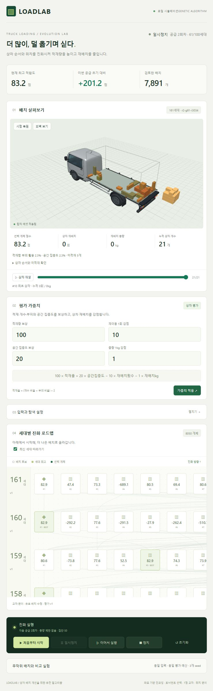

# Stacking boxes onto a truck using a genetic algorithm

**하차 우선순위는 고정하고, 그 순서대로 꺼낼 때 방해 상자의 재이동 횟수와 이동 중량을 줄이는 적재 배치를 유전 알고리즘으로 찾는 3D 웹 실험실입니다.** 적재량·공간 활용 보상과 상부 하중 안정성 평가도 함께 사용합니다.

하차 기준은 사용자 확인에 따라 확정했습니다. 높은 우선순위부터 하차하며 동점은 상자 ID 순입니다. 이동 중량 감점과 상부 하중 초과 감점은 별도로 설정합니다.

[웹에서 실행하기](https://leejonin.github.io/Stacking-boxes-onto-a-truck-using-a-genetic-algorithm/) · [배포 상태](https://github.com/leejonin/Stacking-boxes-onto-a-truck-using-a-genetic-algorithm/deployments/github-pages)

## 주요 기능

- **개수 제한 없는 자동 공급:** 첫 입력을 모두 실어도 새 상자를 공급하며 진화를 이어갑니다. 기본은 최초 20개·추가 묶음 20개이며 입력과 탐색 설정에서 공급량을 바꿀 수 있습니다. 현재 입력을 모두 실은 후보가 나오면 즉시 다음 묶음을 공급하며, 미적재가 남으면 회차 탐색 종료 시 추가 공급합니다. 공급량은 총량 상한이 아닙니다. 사용자는 직접 정지할 수 있습니다. 추가 적재 공간이 없으면 해당 세대의 상차 완료를 표시하고 다음 세대로 계속 진화합니다. 전체 실행은 한 개체라도 설정한 완료 적재율 이상(기본100%, 남은 공간0%)에 도달하면 완료하고 해당 개체를 표시합니다. 입구 막힘만으로는 공간 소진으로 보지 않습니다.
- **실제 GA 계산:** 적재 좌표와 실제 상차 가능성을 탐색하고 하차 비용으로 선택·교차·변이를 수행하며 엘리트 1개를 보존합니다.
- **세대별 계보:** 1세대부터 위로 쌓이는 개체와 실제 부모 연결을 탐색합니다. 과거 개체는 당시 입력으로 확인할 수 있습니다.
- **3D 상·하차 재생:** 기본은 실제 적재된 배치에서 우선순위 하차를 재생합니다. 임시 꺼냄·복귀·최종 하차를 확인하고 상차 보기로 전환할 수 있습니다.
- **가중치와 실행 제어:** 평가 기준을 수정하고 시작·일시정지·재개·정지·초기화를 사용할 수 있습니다.
- **수동 실험:** 고정 입력 또는 순차 도착·대기 공간 40개 모드로 비교합니다. 대기 공간은 총 적재량의 상한이 아닙니다.
- **비교 실험:** 동일 입력과 평가 예산으로 GA와 무작위 탐색을 비교하고 JSON 결과를 저장합니다.



## 실행 환경과 로컬 실행

Node.js 24, npm을 사용합니다.

```sh
git clone https://github.com/leejonin/Stacking-boxes-onto-a-truck-using-a-genetic-algorithm.git
cd Stacking-boxes-onto-a-truck-using-a-genetic-algorithm
npm ci
npm run dev
```

터미널에 표시된 로컬 주소로 접속합니다. 기본값은 `http://127.0.0.1:5173/`입니다. 계산은 브라우저의 Web Worker에서 수행하며 별도 서버·DB·API 키는 필요하지 않습니다.

## 사용 방법

1. **처음부터 시작**을 누릅니다. 기본은 자동 공급 모드입니다.
2. 오른쪽 세대 트리의 개체를 클릭하면 왼쪽에서 실제 상차 결과와 점수를 확인합니다.
3. **상차 재생**을 누르거나 슬라이더로 각 동작을 살펴봅니다.
4. 가중치를 수정하고 **가중치 적용**을 누르면 일시정지 후 현재 집단을 재평가합니다. **이어서 실행**으로 계속합니다.
5. 완료 적재율은 **입력과 탐색 설정 → 완료 적재율 (%)**에서 1~100%로 설정합니다. 기본100%, 소수 입력 가능하며 실행 시작 전 변경합니다. 예:90이면 한 개체라도 실제 짐칸 부피90% 이상에서 완료합니다. 추가 공간 없음은 세대 상차 완료 표시이며 다음 세대로 계속 진화합니다.
6. 상자 공급과 가상 적재함 치수, 탐색 설정은 **입력과 탐색 설정**에서 조절합니다. 고정 입력을 사용하려면 자동 공급을 끕니다.
6. 비교 실험은 하단 패널에서 시작하고 결과 JSON을 저장할 수 있습니다.

## 입력과 필수 조건

상자는 CJ대한통운의 5등급 크기·중량 기준 안에서 무작위 생성합니다.

- 극소형: 세 변 합 80cm / 2kg 이하
- 소형: 100cm / 5kg 이하
- 중형: 120cm / 10kg 이하
- 대형: 140cm / 15kg 이하
- 특대형: 160cm / 20kg 이하

최장변은 모든 등급에서 100cm 이하입니다. 크기와 중량 중 더 큰 등급으로 판정합니다. 각 등급 20% 추첨과 최소 변 10cm는 이 실험의 생성 설정이며 실제 물류 분포를 뜻하지 않습니다. [CJ대한통운 상품규격](https://www.cjlogistics.com/ko/utility/parcel-price)

상자는 적재함 안에 있어야 하고 서로 겹치거나 떠 있으면 안 됩니다. 밑면 전체의 지지와 입구에서 들어오는 경로를 검사합니다. 순차 모드에서 확정한 상자는 고정하며, 못 실은 상자는 미적재로 구분합니다. 가상 적재함의 기본 내부 치수는 폭 220 × 깊이 520 × 높이 220cm이며 실측 차량 제원으로 단정하지 않습니다.

## 평가와 GA 설정

```text
점수 = 100 + 100 × 적재율 + 20 × 공간집중도 + 50 × 짐칸부피활용률
       − 10 × 하차재이동횟수 − 1 × 하차재이동중량(kg)
       − 1 × 상부하중초과분합계(kg)
```

- 적재율: 실린 개수 비율과 실린 부피 비율의 평균. 자동 공급은 최초 공급된 상자의 개수·총 부피를 실행 내내 분모로 유지하므로 새 입력만으로 점수가 하락하지 않습니다. 고정 입력은 해당 입력을 분모로 사용합니다.
- 짐칸부피활용률: 실제 적재 부피 / 짐칸 전체 부피. 기본 최대 보상50점으로80% 적재 시40점,100% 시50점입니다. 평가 가중치의 **짐칸 적재율 보상 (100% 기준)**에서 최대 보상을 바꾸고 가중치 적용을 누르면 현재 집단을 재평가합니다. 완료 적재율(%) 입력과 별도의 점수 설정입니다.
- 공간집중도: 실린 부피 / (적재함 폭 × 높이 × 실린 상자들의 깊이 범위).
- 하차 재이동은 우선순위 상자를 꺼내기 위한 방해 상자의 임시 꺼냄·복귀 각각1회입니다. 2kg 상자의 꺼냄·복귀는2회·4kg이며 최종 하차 자체는 추가 재이동 감점이 없습니다. 하차 순서는 높은 priority 우선, 동점은 ID 오름차순입니다.
- 상부 하중은 적재된 상태에서 위 상자의 자기 무게와 전달받은 하중을 접촉 면적 비율로 아래에 전달합니다. 각 상자마다 `max(0, 받는 상부 총중량 − 자기 무게)`를 합산합니다. 1kg 상자 위에5kg 상자면 초과4kg입니다. 이 값은 하차 이동 중량과 별도 감점입니다. 자기 무게를 허용 하중으로 사용하는 실험 규칙이며 실제 포장재 압축강도나 차량 안전 인증을 뜻하지 않습니다.
- 기존 상차 가능성·누적 보존·재이동 원자료 계산은 유지합니다. 하차 실험 재생은 후보를 비교하기 위한 가상 실행이며 자동 공급의 실제 적재 스냅샷을 비우지 않습니다.
- 하드 제약 위반은 평가 대상에서 제외합니다. 서로 다른 상자는 전체 입력·추가 공급 과정에서 고유 ID를 사용합니다. 같은 상자는 세대가 바뀌거나 재배치되어도 원래 ID를 유지합니다. 상자 간 부피 겹침은 금지하며 면 접촉은 허용합니다. 부분 적재는 위반과 구별합니다.

기본 설정은 집단 50개, 공급 회차당 100세대, 토너먼트 k=3, 교차율 0.9, 변이율 0.05입니다. 공급 회차가 바뀌면 선택한 배치의 실제 적재 상태·누적 비용을 확정하고 기존 상자를 모두 유지하는 집단·상차 순서·실제 부모 연결을 계승합니다. 기존 상자를 유실하는 후보는 제외하며 유효 후보를 만들지 못한 경우 검증된 부모를 보존합니다. 기존 좌표를 먼저 배치한 뒤 미적재 상자를 추가하는 변이를 함께 탐색합니다. 좌표 복구로 지지 관계가 달라지면 일부 자식의 상차 순서 유전자도 복구합니다. 최초 입력보다 더 싣거나 공간 보상을 받으면 100점을 넘을 수 있습니다. PPT의 하차 비용 기준에 적재량·활용률 보상과 별도 상부 하중 감점을 더한 식이며100점 만점이 아닙니다.

## 검증

```sh
npm test
npm run build
npm run experiment
npx --no-install tsx scripts/smoke-loading.ts
```

현재 수치·회귀 테스트는 51개입니다. 규격·지지·상차 비용·미적재·고정 좌표·운전석 비침범·자동 공급의 실제 Worker 회차 전환을 검사합니다. 100→101세대의 부모 연결·점수 보존·18개 초과 적재를 회귀 검사합니다. 모든 기기와 브라우저 조합의 검증을 뜻하지는 않습니다.

실험 결과는 `artifacts/`에 저장하며 Git에 포함하지 않습니다. GA가 항상 무작위 탐색보다 좋거나 전역 최적해를 찾는다고 보장하지 않습니다. 완료의 추가 불가 판정은 현재 개체의 경계·충돌·밑면 지지에 따른 최소 상자 공간 검사이며 모든 재배치의 전역 최적성 증명은 아닙니다. 적재량과 재배치의 선형 가중 합을 사용하므로 가중치에 따라 결과가 달라집니다.

## 프로젝트 구조

- `src/domain/`: 상자 자료형·생성·배치와 제약 검사
- `src/simulation/`: 상차 가능성·우선순위 하차·정적 상부 하중·택배 도착·자동 공급
- `src/ga/`: 좌표·순서 진화와 비교 실험
- `src/workers/`: 계산 및 실행 상태 처리
- `src/scene/`: 3D와 실제 탑차 에셋 좌표 보정
- `src/ui/`: 세대 트리·설정·실행 제어
- `tests/`, `scripts/`: 회귀 검사·실험 실행
- `Asset/`: 탑차·상자 재질 에셋과 출처 안내
- `Info/`: 원본 계획서·구현 계획·기능별 코드 설명·작업 기록

세부 문서는 [기능 ID 목록](Info/기능_ID_목록.md), [기술 환경](Info/기술환경.md), [구현 계획](Info/plan/2026-11-10/164151_탑차상자배치_GA구현_plan.md), [에셋 출처](Asset/ASSETS.md)를 참고하세요. 원본 PPTX와 과거 day는 당시 기록이며 최신 사용자 정정과 구현을 함께 확인해야 합니다.

## GitHub Pages 배포

소스는 `main`, 실행 파일은 `gh-pages` 브랜치에서 관리합니다. GitHub Pages의 게시 소스는 `gh-pages` 브랜치의 루트입니다.

```sh
npm run deploy
```

위 명령은 Pages 하위 경로로 빌드한 뒤 기존 GitHub CLI 인증으로 빌드 결과만 `gh-pages`에 게시합니다. `main` 소스 push는 별도로 수행합니다. GitHub CLI 로그인과 저장소 push 권한이 필요하며 토큰을 소스에 저장하지 않습니다. Vite는 배포용 저장소 이름을 사용해 에셋·Worker 경로를 맞추고 로컬 개발은 루트 경로를 사용합니다.

현재 인증에 없는 Actions workflow 권한을 추가로 요구하지 않는 브랜치 게시 방식입니다. `.github/pages-actions-reference.yml`은 참고용이며 자동 실행되는 워크플로가 아닙니다.

공개 저장소에는 소스·에셋·계획서·개발 문서·의존성 잠금 파일을 포함하며 `node_modules/`, `.npm-cache/`, `dist/`, 임시 실험 결과는 제외합니다.
