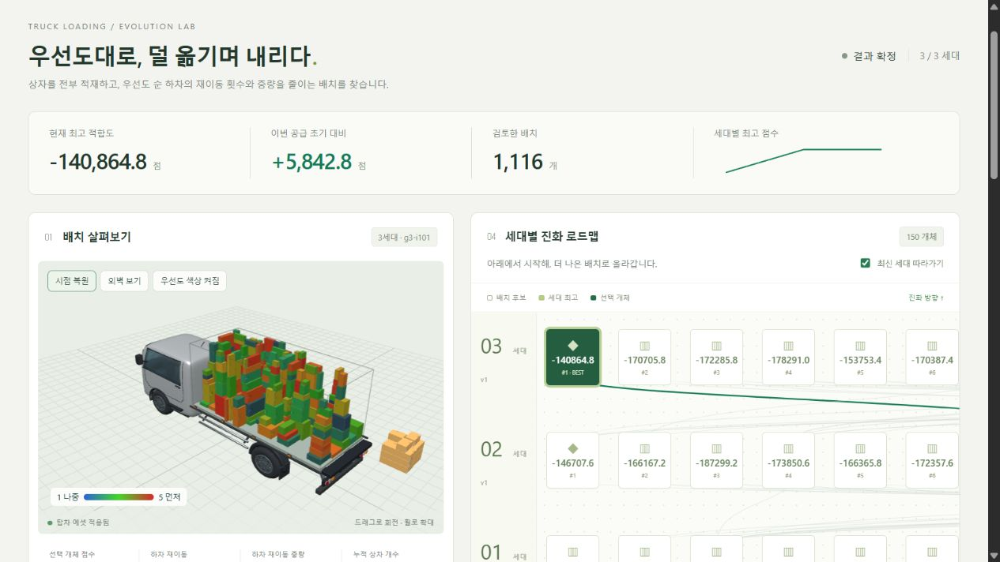
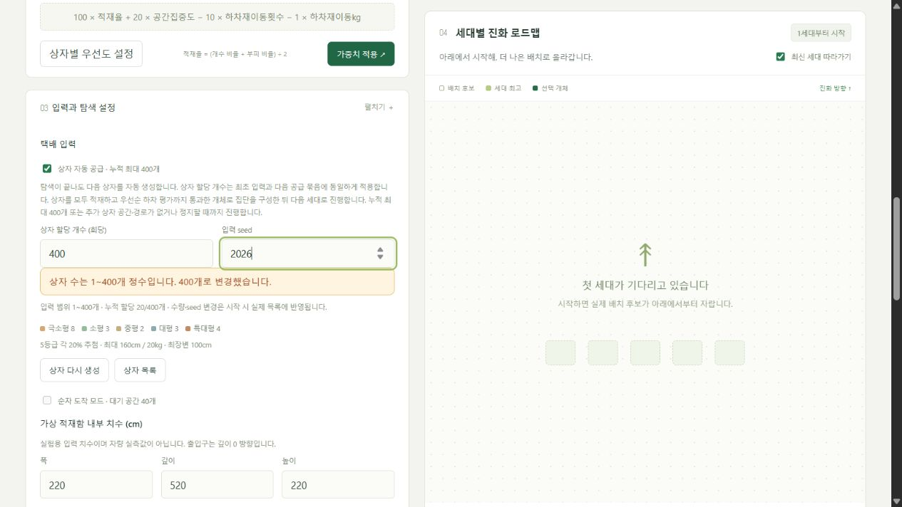
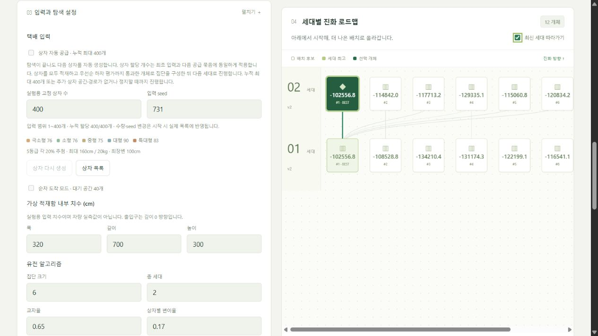

# Stacking boxes onto a truck using a genetic algorithm




**상자별 우선도 순서대로 하차할 때 재이동 횟수와 중량이 적은 탑차 배치를 찾는 유전 알고리즘 웹 실험실입니다.** 먼저 할당 상자 전부를 겹침·지지 위반 없이 적재할 수 있어야 합니다.

[웹에서 실행하기](https://leejonin.github.io/Stacking-boxes-onto-a-truck-using-a-genetic-algorithm/) · [배포 상태](https://github.com/leejonin/Stacking-boxes-onto-a-truck-using-a-genetic-algorithm/deployments/github-pages)

2026-11-17 사용자 승인으로 참고 표시였던 우선도를 실제 하차 평가에 연결했습니다. 과거 상차 전용 점수·성능 기록은 해당 시점의 Info 문서에 보존합니다.

## 우선도와 평가 기준

- **우선도 5가 먼저, 1이 나중**입니다. 같은 우선도는 상자 ID 오름차순으로 하차합니다. 생성 범위는 1.0–5.0이며 직접 수정할 수 있습니다.
- 우선도는 상자의 입력값입니다. 같은 상자는 세대가 바뀌어도 ID·우선도를 유지하며 GA가 배송 순서를 바꿔 감점을 피하지 못합니다.
- GA는 좌표와 상차 순서를 선택·교차·변이하고, 실제 적재 가능성과 우선순 하차를 실행해 배치를 평가합니다. 엘리트 1개를 보존합니다.
- 배송 하차 `deliver`는 재이동에서 제외합니다. 방해 상자를 임시로 꺼내는 `out`과 복귀 `return`은 각각 1회·해당 중량입니다. 2kg 상자 왕복은 **2회·4kg**이며 같은 상자를 반복 이동하면 매번 합산합니다.

```text
점수 = 100 × 적재율 + 20 × 공간집중도
       − 10 × 우선순 하차 재이동 횟수 − 1 × 우선순 하차 재이동 중량(kg)
```

적재율은 실린 개수 비율과 부피 비율의 평균, 공간집중도는 적재 부피를 적재함 폭×높이×적재물 깊이 범위로 나눈 값입니다. 기본 가중치 100·20·10·1은 화면에서 변경할 수 있습니다. 완전 적재 집단이므로 적재율은 1이며 **점수는 음수가 될 수 있습니다.** 상차 재배치 비용은 별도로 표시하고 주 GA 감점에 섞지 않습니다.

입구 경로를 막는 상자와 지지를 잃는 윗상자를 먼저 꺼낸 뒤 배송합니다. 복귀는 원래 위치·낮은 지지면·빈 구획을 검사합니다. 국소 복귀가 불가능하면 남은 상자를 추가로 임시 이동해 안전하게 재적재하며 **추가 이동도 모두 감점**합니다. 끝내 안전한 복귀 계획이 없으면 후보를 거부합니다. 평가기는 한 출입구의 직선 이동과 밑면 전체 지지를 사용하며 작업 시간·회전 동작을 모델링하지 않습니다. 하차 임시 대기 공간의 별도 용량 상한은 없으며 순차 입력의 대기 40개 조건과 구분됩니다.

## 사용 방법

1. **입력과 탐색 설정**에서 할당 수·seed·짐칸·집단·세대를 정하고 **상자 다시 생성**을 누릅니다.
2. **상자별 우선도 설정**에서 각 ID의 값을 수정합니다. 배송 순위를 바로 확인할 수 있습니다. 수정값은 같은 입력의 초기화·처음부터 시작에도 유지합니다. 명시적으로 다시 생성하면 seed 기반 새 값으로 돌아갑니다.
3. **처음부터 시작**을 누릅니다. 실행·완료·순차 도착 이후에는 우선도 입력을 잠급니다. 수량·seed만 바꾼 미생성 목록도 잠그므로 다시 생성 후 수정합니다.
4. 세대 트리에서 개체를 선택하고 **우선도 하차 → 하차 재생**으로 배송·임시 이동·복귀를 봅니다. **상차 확인**에서는 빈 적재함부터 상차 과정을 확인합니다.
5. 3D 색상은 **1 파랑 → 5 빨강**입니다. 색상 토글을 끄면 상자 등급 재질을 표시합니다. 현재 이벤트에는 ID·우선도·누적 비용을 함께 표시합니다.
6. 가중치는 첫 세대 준비 중에도 적용할 수 있습니다. 현재 집단을 재평가하고 일시정지하며 새 가중치의 현재 최고·선택 점수를 즉시 표시합니다. 과거 세대 점수는 당시 기록으로 보존합니다. 시작·일시정지·재개·정지·초기화를 제공합니다.
7. **완료 · 결과 확정**을 누르면 그 시점의 완성 세대·선택 개체·카메라·재생 단계를 보관하고 다운로드를 엽니다. 준비 중 세대는 제외합니다.

## 결과 다운로드

로드맵, 최고·평균 점수, 하차 재이동 횟수/중량, 적재 개수/활용, 세대 요약, **선택 개체의 상자별 우선도·배송 순위**, 3D 이미지를 저장합니다. 그래프·표는 PNG/SVG, 3D는 PNG입니다. 여러 장과 전체 결과는 ZIP이며 JSON 원자료·안내를 포함합니다.

모든 이미지에 완료시각·목적·우선도 규칙·단위·가중치·입력/탐색 설정을 넣습니다. 로드맵은 6세대×10개체, 세대 요약과 우선도표는 30행씩 분할합니다. 공급 회차·평가 버전 경계에서는 추세선을 끊습니다. 3D는 완료 당시 재생 단계이며, 최종 평가 수치와 현재 화면을 구분합니다.

완료 후 다른 개체를 둘러봐도 확정 자료는 바뀌지 않습니다. 새 실행·초기화는 다운로드를 다시 잠급니다. 결과는 페이지 메모리에만 있으므로 **새로고침 전에 저장**하세요. JSON 재입력은 미지원입니다. 많은 세대의 PNG/JSON ZIP은 시간·메모리를 사용하므로 SVG 또는 세대 범위 분할을 사용할 수 있습니다.

## 입력과 전량 적재 조건

CJ대한통운 5등급 상한 안에서 상자를 무작위 생성합니다.

- 극소형: 세 변 합 80cm / 2kg 이하
- 소형: 100cm / 5kg 이하
- 중형: 120cm / 10kg 이하
- 대형: 140cm / 15kg 이하
- 특대형: 160cm / 20kg 이하

최장변 100cm 이하, 최소 변 10cm, 등급별 20% 추첨은 실험 설정이며 실제 물류 분포를 뜻하지 않습니다. 크기·중량을 모두 수용하는 최소 등급으로 판정합니다. [CJ대한통운 상품규격](https://www.cjlogistics.com/ko/utility/parcel-price)

기본 가상 내부 치수는 폭220×깊이520×높이220cm이며 차량 실측값이 아닙니다. 상자는 경계를 넘거나 겹치거나 떠 있으면 안 됩니다. **집단의 모든 개체가 전량 상차·유효한 우선순 하차 평가를 통과해야 세대를 올립니다.** 짐칸을 100% 채우는 조건은 아닙니다. 치수·총부피가 불가능하거나 유한 탐색에서 유효 집단을 못 만들면 원인을 알립니다.

상자 수는 **최소1개·누적 최대400개**입니다. 초과 입력은 경고와 함께400으로, 빈값·0·음수는 편집 완료 시1로 보정합니다. 소수는 정수로 보정합니다. 기본 자동 공급은 최초와 다음 묶음 각20개이며 마지막 묶음은 남은 누적 한도만큼만 추가합니다. 기존 ID·우선도를 보존하고 누적400개·추가 상차 공간/경로 없음·사용자 정지에서 종료합니다. 수량·seed 수정은 고정/자동 일반 실행과 비교실험 시작 시 실제 목록에 반영되므로 다시 생성 버튼을 누르지 않아도 됩니다. 순차 도착 중 입력 변경은 다시 생성 후 사용합니다. 고정 입력은 자동 공급을 끄며 순차 도착 모드의 대기40개도 총량 상한과 다릅니다.

## 개발·검증

Node.js24와 npm을 사용합니다. 계산은 브라우저 Web Worker에서 수행하며 서버·DB·API 키는 필요하지 않습니다.

```sh
npm ci
npm run dev
npm test
npm run build
npm run benchmark -- --large --priority --generations=3
```

75개 회귀 검사는 우선도 교환의 점수 변화(100↔76), 동점 ID순, 실제 GA 개선, 잘못된 입력, 220개 모든 이벤트의 경계·겹침·지지·인출 경로·ID·순서·비용, 내보내기·Worker 100/220개를 포함합니다. 추가로 비기본100/256/360/400개 설정·첫 세대 전 가중치·390→400 공급 종료를 검사합니다. 기존 상차 호환 검사도 유지합니다. 같은 복귀 정책의 인덱스 최적화 전후 6·20·100·220개 전체 이벤트 해시가 일치합니다.

새 웹은 항상 우선도 하차 목적을 명시합니다. 독립 Engine/Worker API의 생략 기본값과 `--priority` 없는 벤치마크는 과거 상차 호환 경로이며 출력의 `objective`로 구분합니다. 이전 상차 전용 성능 수치를 하차 계산이 추가된 현재 웹의 시간으로 주장하지 않습니다. GA가 전역 최적해를 찾거나 모든 입력에서 일정 시간 안에 완전 적재를 보장하지는 않습니다.

구현은 `src/domain/`(입력·우선도·배치/빈 공간), `src/simulation/`(상차·우선순 하차·비용), `src/ga/`, `src/workers/`, `src/scene/`, `src/ui/`, `src/export/`로 나눕니다. [기능 ID 목록](Info/기능_ID_목록.md), [기술 환경](Info/기술환경.md), [에셋 출처](Asset/ASSETS.md), Info의 최신 계획·day를 참고하세요.

## 배포

소스는 `main`, 실행 파일은 `gh-pages` 브랜치 루트에서 GitHub Pages로 게시합니다.

```sh
npm run deploy
```

Pages 하위 경로로 빌드하고 기존 GitHub CLI 인증으로 빌드 결과를 게시합니다. 소스 push는 별도이며 토큰을 소스에 저장하지 않습니다. `.github/pages-actions-reference.yml`은 참고 파일입니다. 공개 저장소는 소스·에셋·계획서·개발 문서·잠금 파일을 포함하며 `node_modules/`, `dist/`, 캐시·`artifacts/` 임시 검증 결과는 제외합니다.


입력 범위와 실제400개 실행 확인 화면:




